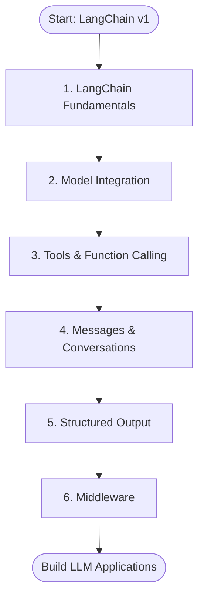
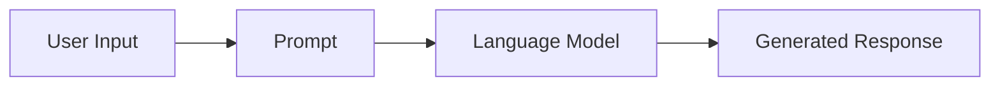
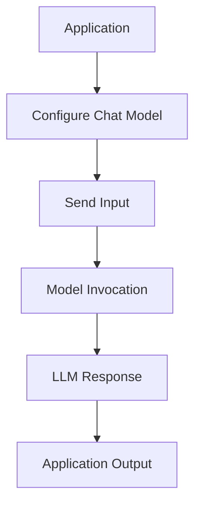
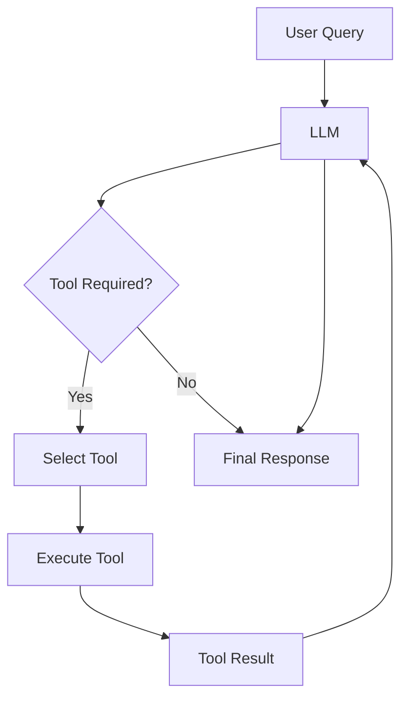
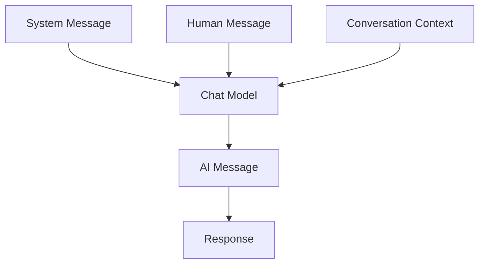
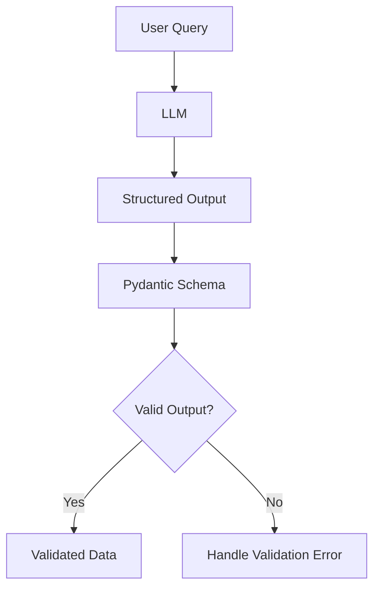
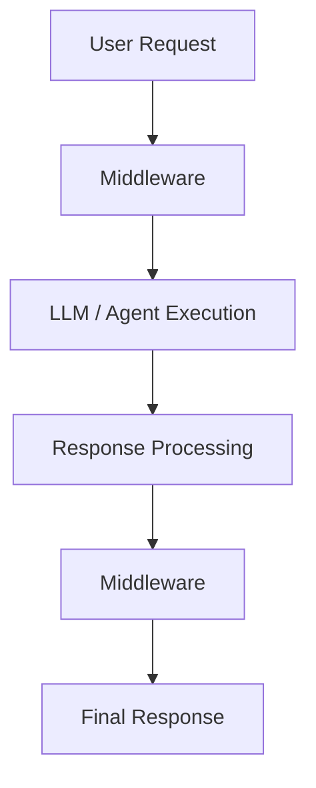

# 🦜 LangChain — Updated Framework & Core Concepts

A hands-on learning module exploring the updated LangChain framework and its essential components for building modern LLM-powered applications.

This section of **GenerativeAI-Learn** focuses on understanding how LangChain integrates language models, tools, messages, structured outputs, and middleware to build reliable and extensible AI applications.

The notebooks follow a progressive learning approach, starting with the fundamentals of LangChain and moving toward advanced model interactions and application-level control.

---

## 📚 Notebooks & Concepts

| # | Notebook | Concepts Covered |
|---|---|---|
| 1 | [LangChain Fundamentals](./1-langchainv1.ipynb) | LangChain v1, model invocation, prompts, basic LLM workflows |
| 2 | [Model Integration](./2-Model_Integration.ipynb) | Chat model integration, model configuration, LLM interaction |
| 3 | [Tools](./3-Tools.ipynb) | Tool creation, function calling, connecting LLMs with external functions |
| 4 | [Messages](./4-messages.ipynb) | System, Human, AI messages, message-based conversations |
| 5 | [Structured Output](./5-Structured_Output.ipynb) | Structured responses, schemas, Pydantic, JSON-based outputs |
| 6 | [Middleware](./6-Middleware.ipynb) | Middleware integration, execution control, extending agent behavior |

---

## 🧭 Learning Roadmap

---

## 1️⃣ LangChain Fundamentals

**Notebook:** [📓 1-langchainv1.ipynb](./1-langchainv1.ipynb)

Explore the updated LangChain framework and understand how to construct basic LLM-powered applications.

### Key Concepts
- Introduction to LangChain v1
- LLM application development
- Model invocation
- Prompt-based interactions
- Basic LangChain workflow

### Workflow

**Learning Objective:** Understand the fundamentals of LangChain and establish a foundation for developing LLM applications.

---

## 2️⃣ Model Integration

**Notebook:** [📓 2-Model_Integration.ipynb](./2-Model_Integration.ipynb)

Learn how to integrate language models into LangChain applications and interact with them through a consistent interface.

### Key Concepts
- Chat model integration
- Model initialization
- Model configuration
- Invoking language models
- LLM-based application workflows

### Workflow

**Learning Objective:** Understand how to connect and use language models within LangChain applications.

---

## 3️⃣ Tools & Function Calling

**Notebook:** [📓 3-Tools.ipynb](./3-Tools.ipynb)

Explore how language models can interact with external functions and tools to extend their capabilities beyond text generation.

### Key Concepts
- Tool creation
- Function calling
- Tool binding
- External function execution
- LLM and tool integration

### Workflow

**Learning Objective:** Understand how LLMs can interact with external tools and execute functions based on user requests.

---

## 4️⃣ Messages & Conversations

**Notebook:** [📓 4-messages.ipynb](./4-messages.ipynb)

Understand the message-based communication system used by LangChain chat models.

### Key Concepts
- System messages
- Human messages
- AI messages
- Message roles
- Conversation structure

### Workflow

**Learning Objective:** Understand how different message types influence model behavior and conversational interactions.

---

## 5️⃣ Structured Output

**Notebook:** [📓 5-Structured_Output.ipynb](./5-Structured_Output.ipynb)

Learn how to transform natural language model responses into structured and machine-readable data.

### Key Concepts
- Structured responses
- Pydantic schemas
- JSON output
- Schema-based validation
- Reliable LLM outputs

### Workflow

**Learning Objective:** Build applications that produce predictable, structured, and machine-readable LLM responses.

---

## 6️⃣ Middleware

**Notebook:** [📓 6-Middleware.ipynb](./6-Middleware.ipynb)

Explore middleware as a mechanism for extending and controlling the behavior of LLM-powered applications and agents.

### Key Concepts
- Middleware integration
- Execution control
- Extending agent behavior
- Application-level processing
- Customization of LLM workflows

### Workflow

**Learning Objective:** Understand how middleware can be used to customize, monitor, and control LLM application execution.

---

## 🛠️ Technology Stack

| Technology | Purpose |
|---|---|
| Python | Core programming language |
| LangChain | LLM application framework |
| Chat Models | Natural language processing and generation |
| Pydantic | Schema definition and data validation |
| Jupyter Notebook | Interactive learning and experimentation |

---

## 🎯 Learning Outcomes

After completing this module, you should be able to:

- Build basic LLM applications using LangChain v1.
- Integrate chat models into Python applications.
- Create and bind tools to language models.
- Understand message-based interactions.
- Generate structured and validated LLM outputs.
- Extend application behavior using middleware.
- Develop a foundation for building LangChain-based AI agents.

---

## 🚀 What's Next?

After completing the Updated LangChain module, continue exploring:

- **[Advance RAG](../Advance%20RAG/)** — Advanced retrieval architectures and optimization techniques.
- **[Agentic AI](../Agentic%20AI/)** — LangGraph, agent architectures, tool calling, and agentic workflows.
- **[RAG](../RAG/)** — Retrieval-Augmented Generation fundamentals and implementation.

---

⭐ If you find this repository helpful, consider giving it a star!

**Author:** [connectwithaadi](https://github.com/connectwithaadi)

**Repository:** [GenerativeAI-Learn](https://github.com/connectwithaadi/GenerativeAI-Learn)

