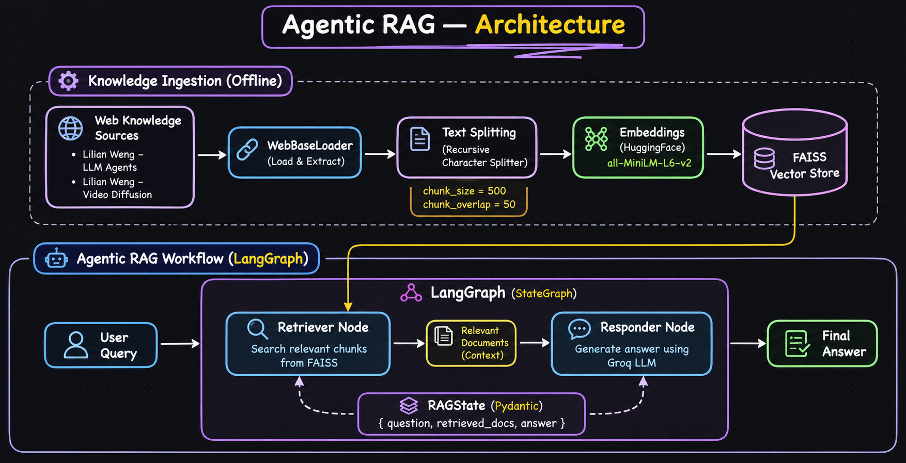

# 🤖 Agentic RAG — LangGraph Powered Retrieval-Augmented Generation

An Agentic Retrieval-Augmented Generation (RAG) system built using **LangGraph, LangChain, FAISS, HuggingFace Embeddings, and Groq**.

This project demonstrates how an LLM can retrieve relevant information from external knowledge sources and generate context-aware responses using a graph-based workflow.

The system retrieves information from web-based documents, performs semantic search using FAISS, and generates answers using Groq's GPT-OSS 120B model.

## ✨ Features

- 🌐 Load knowledge from web-based documents
- 📄 Extract and process web page content
- ✂️ Text chunking with configurable chunk size and overlap
- 🧠 Semantic embeddings using HuggingFace Sentence Transformers
- 🗄️ Vector storage and similarity search using FAISS
- 🔍 Context retrieval through a retriever
- 🤖 LLM-powered answer generation using Groq
- 🔄 Graph-based workflow orchestration using LangGraph
- 📦 Structured state management using Pydantic
- 🎯 Context-aware question answering

## 🏗️ System Architecture



## 🔄 Workflow

### 1. Document Loading

The application loads external web content using `WebBaseLoader`.

The knowledge sources include:

- [LLM Powered Autonomous Agents — Lilian Weng](https://lilianweng.github.io/posts/2023-06-23-agent/)
- [Video Diffusion Models — Lilian Weng](https://lilianweng.github.io/posts/2024-04-12-diffusion-video/)

### 2. Document Chunking

The extracted documents are split into smaller chunks using `RecursiveCharacterTextSplitter`.

```python
splitter = RecursiveCharacterTextSplitter(
    chunk_size=500,
    chunk_overlap=50
)

split_docs = splitter.split_documents(docs)
```

| Parameter | Value | Purpose |
|---|---|---|
| chunk_size | 500 | Maximum chunk size |
| chunk_overlap | 50 | Preserve context between chunks |

### 3. Embedding Generation

Document chunks are converted into numerical vectors using the Sentence Transformers model.

```python
embedding = HuggingFaceEmbeddings(
    model_name="sentence-transformers/all-MiniLM-L6-v2"
)
```

### 4. Vector Store Creation

FAISS stores the generated embeddings and enables semantic similarity search.

```python
vectorstore = FAISS.from_documents(
    split_docs,
    embedding
)

retriever = vectorstore.as_retriever()
```

### 5. Retrieval Node

The retriever searches for relevant document chunks based on the user's question.

```python
def retrieve_docs(state: RAGState) -> RAGState:
    docs = retriever.invoke(state.question)

    return RAGState(
        question=state.question,
        retrieved_docs=docs
    )
```

### 6. Responder Node

The retrieved document content is combined with the user's question and passed to the Groq LLM.

```python
def generate_answer(state: RAGState) -> RAGState:

    context = "\n\n".join(
        [doc.page_content for doc in state.retrieved_docs]
    )

    prompt = f"""
    Answer the question based on the context.

    Context:
    {context}

    Question: {state.question}
    """

    response = llm.invoke(prompt)

    return RAGState(
        question=state.question,
        retrieved_docs=state.retrieved_docs,
        answer=response.content
    )
```

### 7. LangGraph Workflow

The graph connects the Retriever and Responder nodes.

```python
builder = StateGraph(RAGState)

builder.add_node("retriever", retrieve_docs)
builder.add_node("responder", generate_answer)

builder.set_entry_point("retriever")

builder.add_edge("retriever", "responder")
builder.add_edge("responder", END)

graph = builder.compile()
```

## 🛠️ Tech Stack

| Component | Technology |
|---|---|
| Programming Language | Python |
| LLM | Groq — GPT-OSS 120B |
| LLM Integration | LangChain |
| Workflow Orchestration | LangGraph |
| Embeddings | HuggingFace Sentence Transformers |
| Embedding Model | all-MiniLM-L6-v2 |
| Vector Database | FAISS |
| Document Loader | WebBaseLoader |
| Text Splitting | RecursiveCharacterTextSplitter |
| State Management | Pydantic |
| Configuration | python-dotenv |

## 📁 Project Structure

```text
1-AgenticRAG/
│
├── 1-AgenticRag.ipynb
├── README.md
└── .env
```

## ⚙️ Installation and Setup

### 1. Clone the Repository

```bash
git clone https://github.com/connectwithaadi/GenerativeAI-Learn.git

cd GenerativeAI-Learn

cd "Agentic AI/3-Agentic RAG/1-AgenticRAG"
```

### 2. Install Dependencies

```bash
pip install langchain-community
pip install langchain-text-splitters
pip install langchain-groq
pip install langchain-huggingface
pip install langgraph
pip install sentence-transformers
pip install faiss-cpu
pip install python-dotenv
pip install beautifulsoup4
```

### 3. Configure Environment Variables

Create a `.env` file in the project directory.

```env
GROQ_API_KEY=your_groq_api_key
```

Get your API key from the [Groq Console](https://console.groq.com/keys).

**Security:** Never commit your `.env` file or expose your API key in source code.

### 4. Run the Notebook

Open the notebook:

```bash
jupyter notebook 1-AgenticRag.ipynb
```

Execute the cells sequentially to:

1. Initialize the Groq LLM.
2. Load web documents.
3. Split documents into chunks.
4. Generate embeddings.
5. Create the FAISS vector store.
6. Initialize the retriever.
7. Build the LangGraph workflow.
8. Execute the RAG pipeline.

## 💡 Example

**Input Question:**

```text
What is the concept of agent loop in autonomous agents?
```

**Workflow:**

```text
User Question
     ↓
Retriever Node
     ↓
Relevant Documents
     ↓
Responder Node
     ↓
Groq GPT-OSS 120B
     ↓
Final Answer
```

The LLM generates a response using the retrieved document context.

## 🧠 Concepts Demonstrated

- Retrieval-Augmented Generation (RAG)
- Agentic RAG fundamentals
- LangGraph StateGraph
- Graph-based workflow orchestration
- Semantic search
- Vector embeddings
- FAISS vector database
- Document preprocessing
- LLM integration
- Pydantic state management
- Context-based answer generation

## 🚀 Future Improvements

- Add conditional routing between multiple retrieval tools.
- Implement iterative retrieval and reflection.
- Add query rewriting for improved retrieval quality.
- Integrate hybrid search (BM25 + semantic search).
- Add reranking for better document relevance.
- Include source citations in generated answers.
- Implement conversational memory.
- Add streaming responses.
- Introduce tool-calling capabilities.
- Build a FastAPI backend.
- Add evaluation using RAGAS.
- Deploy the application.

## 🎯 Learning Goal

This project explores how Retrieval-Augmented Generation can be orchestrated using LangGraph.

It demonstrates the fundamental building blocks of an agentic retrieval workflow:

**Knowledge Sources → Retrieval → Context → LLM → Answer**

The implementation provides a foundation for building more advanced Agentic RAG systems with query routing, tool usage, iterative retrieval, and multi-agent orchestration.

## 👨‍💻 Author

**Aditya Kumar Singh**

GitHub: [@connectwithaadi](https://github.com/connectwithaadi)

---

*Built to explore Agentic AI, LangGraph, Retrieval-Augmented Generation, semantic search, and LLM-powered applications.*

