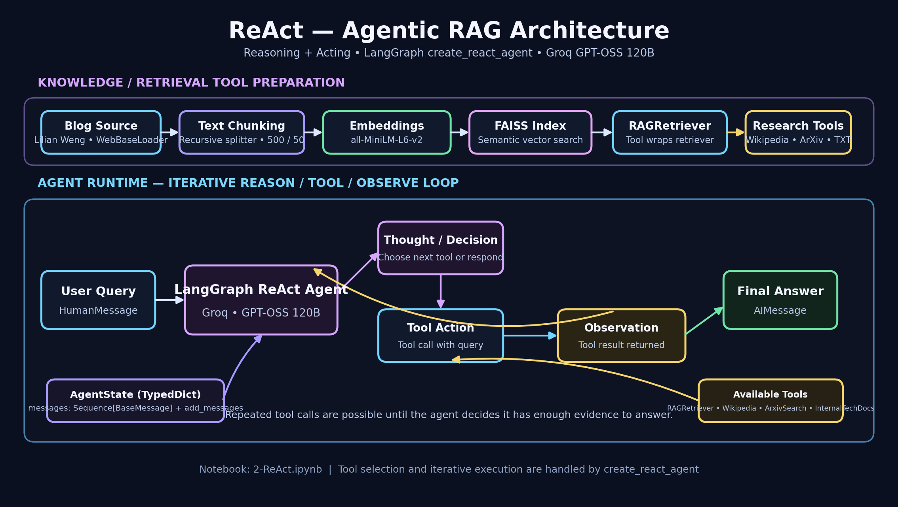

# 🤖 ReAct Agent — Agentic RAG

An intelligent **ReAct (Reasoning + Acting) Agent** built using LangGraph and Groq. This project demonstrates how an AI agent can reason about a user query, dynamically select tools, observe their results, and iteratively generate a context-aware response.

The agent combines LLM reasoning with multiple retrieval and research tools to solve complex queries through an iterative execution workflow.

## 🏗️ Architecture



### Workflow

1. **User Query:** The user submits a natural language question.
2. **LLM Reasoning:** The Groq-powered LLM analyzes the query and determines the next action.
3. **Tool Selection:** The agent dynamically selects the appropriate tool.
4. **Tool Execution:** The selected tool retrieves relevant information.
5. **Observation:** The tool output is returned to the agent.
6. **Iterative Reasoning:** The agent evaluates the observation and decides whether another tool call is required.
7. **Final Answer:** Once sufficient information is gathered, the agent generates the final response.

## ✨ Features

- ReAct-based agentic reasoning
- Dynamic tool selection and execution
- Multi-tool integration
- Retrieval-Augmented Generation (RAG)
- Semantic search using FAISS
- Research capabilities through Wikipedia and Arxiv
- LangGraph-based agent orchestration
- Stateful execution using message history
- Natural language query processing

## 🛠️ Tech Stack

| Technology | Purpose |
|---|---|
| Python | Core programming language |
| LangGraph | Agent orchestration |
| LangChain | LLM and tool integration |
| Groq | LLM inference |
| GPT-OSS 120B | Reasoning and response generation |
| FAISS | Vector similarity search |
| HuggingFace Embeddings | Text embeddings |
| Wikipedia | Knowledge retrieval |
| Arxiv | Research paper retrieval |
| Jupyter Notebook | Development and experimentation |

## 🔧 Tools

The agent has access to multiple tools:

- **RAGRetriever:** Retrieves relevant information from a vector database using semantic search.
- **Wikipedia:** Retrieves factual information from Wikipedia.
- **ArxivSearch:** Searches research papers and academic knowledge.
- **InternalTechDocs:** Retrieves information from internal technical documentation.

The agent chooses tools based on the user's query and the information required to generate an answer.

## 🧠 Understanding ReAct

ReAct stands for **Reasoning and Acting**.

It combines the reasoning capabilities of an LLM with external actions such as search and retrieval.

```text
User Query
    ↓
LLM Reasoning
    ↓
Select Tool
    ↓
Execute Tool
    ↓
Observe Result
    ↓
Reason Again
    ↓
Final Answer
```

Unlike a simple LLM chain, a ReAct agent can perform multiple tool calls before generating its final answer.

## 📂 Project Structure

```text
2-ReACT/
│
├── 2-ReAct.ipynb
├── README.md
└── architecture.png
```

## ⚙️ Installation & Setup

### 1. Clone the Repository

```bash
git clone https://github.com/connectwithaadi/GenerativeAI-Learn.git
```

### 2. Navigate to the Project

```bash
cd GenerativeAI-Learn
```

Navigate to the `Agentic AI/3-Agentic RAG/2-ReACT` directory.

### 3. Install Dependencies

```bash
pip install langchain langchain-core langchain-community langgraph langchain-groq faiss-cpu sentence-transformers wikipedia arxiv jupyter
```

### 4. Configure Environment Variables

Create a `.env` file in the project directory.

```env
GROQ_API_KEY=your_groq_api_key
```

Never commit your API keys to GitHub.

### 5. Run the Notebook

```bash
jupyter notebook 2-ReAct.ipynb
```

Execute the notebook cells to initialize the tools and run the ReAct agent.

## 🎯 Learning Objectives

- Understand the ReAct agent architecture.
- Implement tool calling with LangGraph.
- Integrate multiple retrieval sources into an AI agent.
- Understand iterative reasoning and observation.
- Build stateful agent workflows.
- Explore the fundamentals of Agentic RAG.

## 🚀 Future Improvements

- Add web search integration.
- Implement tool error handling and retry mechanisms.
- Add conversation memory.
- Improve retrieval quality with hybrid search.
- Implement agent tracing and observability.
- Deploy the agent using FastAPI and Streamlit.

## 👨‍💻 Author

**Aditya Kumar Singh (Aadi)**

- GitHub: [@connectwithaadi](https://github.com/connectwithaadi)

---

⭐ If you find this project useful, consider giving the repository a star!

