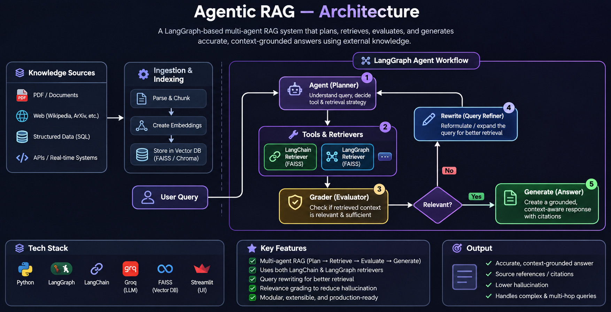

# Agentic RAG Project — LangGraph + LangChain

An **Agentic Retrieval-Augmented Generation (RAG)** notebook that lets an LLM decide whether to retrieve information from knowledge sources, checks retrieved context for relevance, rewrites questions when needed, and generates an answer from the retrieved content.

The project is implemented in `3-AgenticRag-Project.ipynb`.

## Overview

This notebook builds a LangGraph workflow over two separate FAISS vector stores:

1. **LangGraph documentation retriever** — sourced from LangGraph tutorials and how-to pages.
2. **LangChain documentation retriever** — sourced from LangChain tutorial pages.

Each vector store is exposed to the LLM as a retriever tool. The agent can choose a tool to search the appropriate documentation or end without retrieval.

## 🏗️ Architecture




### Workflow components

- **Agent node:** Uses `ChatGroq` with bound retriever tools to decide whether and where to retrieve.
- **Retrieve node:** Executes selected retriever tools through LangGraph's `ToolNode`.
- **Document relevance grader:** Uses structured output (`binary_score: yes/no`) to judge whether retrieved context relates to the question.
- **Rewrite node:** Rephrases the original question to improve its semantic intent before returning to the agent.
- **Generate node:** Uses the `rlm/rag-prompt` from LangChain Hub and the Groq model to generate a context-grounded response.
- **Graph state:** Maintains the message sequence using `AgentState` and LangGraph's `add_messages` reducer.

## Knowledge sources

### LangGraph
- `https://langchain-ai.github.io/langgraph/tutorials/introduction/`
- `https://langchain-ai.github.io/langgraph/tutorials/workflows/`
- `https://langchain-ai.github.io/langgraph/how-tos/map-reduce/`

### LangChain
- `https://python.langchain.com/docs/tutorials/`
- `https://python.langchain.com/docs/tutorials/chatbot/`
- `https://python.langchain.com/docs/tutorials/qa_chat_history/`

Pages are loaded with `WebBaseLoader`, split into chunks using `RecursiveCharacterTextSplitter` (chunk size **1000**, overlap **100**), embedded with `sentence-transformers/all-MiniLM-L6-v2`, and indexed in FAISS.

## Tech stack

- Python
- LangGraph — agent workflow and conditional routing
- LangChain — tools, prompt, document loading, and chains
- Groq — LLM inference (`openai/gpt-oss-120b`; question rewriting uses `qwen-qwq-32b`)
- FAISS — vector similarity search
- Hugging Face Sentence Transformers — embeddings
- LangChain Hub — RAG prompt
- `python-dotenv` — environment configuration

## Setup

### 1. Clone the repository

```bash
git clone https://github.com/connectwithaadi/GenerativeAI-Learn.git
cd GenerativeAI-Learn
```

Navigate to the project directory:

```bash
cd "Agentic AI/3-Agentic RAG/3-AgenticRag-Project"
```

### 2. Create and activate a virtual environment

Windows PowerShell:

```powershell
python -m venv .venv
.venv\Scripts\Activate.ps1
```

macOS / Linux:

```bash
python -m venv .venv
source .venv/bin/activate
```

### 3. Install dependencies

```bash
pip install -U langchain langchain-community langchain-classic langchain-core langchain-text-splitters langchain-groq langchain-huggingface langgraph faiss-cpu sentence-transformers python-dotenv beautifulsoup4 langchainhub
```

> Depending on the versions installed, LangChain package APIs may change. If an import fails, check the package versions and the notebook's imports.

### 4. Configure environment variables

Create a `.env` file in the project directory:

```env
GROQ_API_KEY=your_groq_api_key
```

Keep `.env` private. Do not commit API keys to GitHub.

### 5. Run the notebook

Launch Jupyter:

```bash
jupyter notebook
```

Open `3-AgenticRag-Project.ipynb` and execute the cells in order. The notebook loads web pages and builds the FAISS indexes during execution.

## Example questions

```text
What is LangGraph?
Explain LangGraph workflows.
What is machine learning?
How does LangChain handle chatbot history?
```

The notebook includes example graph invocations for “What is Langgraph?” and “What is Machine learning?”

## Notes

- The FAISS indexes are created in-memory in the notebook; the project does not currently demonstrate persistent index storage.
- The web loaders require internet access to fetch the documentation pages.
- The relevance grader can route to query rewriting when the retrieved content is not judged relevant.
- This is a learning project demonstrating an agentic RAG workflow, not a production deployment.

## Author

**Aditya Kumar Singh (Aadi)**

- GitHub: [connectwithaadi](https://github.com/connectwithaadi)

