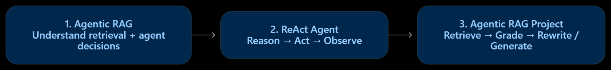

# Agentic RAG — Learning & Implementation

A hands-on learning section exploring **Agentic Retrieval-Augmented Generation (RAG)** through progressively more practical notebooks. This folder brings together three modules: an Agentic RAG introduction, a ReAct tool-using agent, and a documentation-focused Agentic RAG project built with LangGraph.

## 📚 Modules

| Module | Folder | Focus |
|---|---|---|
| 1 | [`1-AgenticRAG`](./1-AgenticRAG/) | Introduction to Agentic RAG concepts and workflows |
| 2 | [`2-ReACT`](./2-ReACT/) | ReAct (Reason + Act) agent with tools and conversational state |
| 3 | [`3-AgenticRag-Project`](./3-AgenticRag-Project/) | Agentic RAG implementation with documentation retrievers, relevance grading, query rewriting, and answer generation |

Open each folder's README for its own notebook details, dependencies, and setup instructions.

## 🧭 Learning Path




### 1. Agentic RAG Fundamentals

Explore how retrieval can become part of an agent's decision-making process instead of a fixed one-pass pipeline. The agentic approach can assess whether evidence is useful and determine whether additional retrieval or refinement is needed.

📂 [Open 1-AgenticRAG](./1-AgenticRAG/)

### 2. ReAct — Reason and Act

Build a conversational agent using LangChain, LangGraph, and Groq. The LLM can select tools, receive observations, and continue until it produces a response.

**Notebook concepts include:**
- Tool binding and tool calling with a Groq chat model
- LangGraph `StateGraph`, `ToolNode`, and `tools_condition`
- arXiv, Wikipedia, Tavily Search, and arithmetic tools
- Message state with `add_messages`
- Thread-level conversation continuity with `MemorySaver`

📂 [Open 2-ReACT](./2-ReACT/)

### 3. Agentic RAG Project

Implement an Agentic RAG workflow using LangGraph and LangChain over LangGraph and LangChain documentation. The LLM chooses whether to use the available retriever tools; retrieved context is graded for relevance, and an unsuitable result can trigger question rewriting before another retrieval attempt.

**Workflow:**
1. User submits a question.
2. Agent chooses a retriever tool or ends without retrieval.
3. `ToolNode` executes the selected retriever.
4. A relevance grader evaluates the retrieved documents.
5. Relevant context goes to answer generation; otherwise, the question is rewritten and returned to the agent.

**Technologies:** LangGraph, LangChain, Groq, FAISS, Hugging Face Sentence Transformers, LangChain Hub.

📂 [Open 3-AgenticRag-Project](./3-AgenticRag-Project/)

## 🧰 Common Technologies

- **Python** — notebook implementation
- **LangChain** — LLM integration, tools, document loading, and prompts
- **LangGraph** — graph state, node orchestration, and conditional routing
- **Groq** — LLM inference
- **FAISS** — vector similarity search in the project module
- **Tavily, arXiv, Wikipedia** — external tools in the ReAct module
- **Hugging Face Sentence Transformers** — embeddings in the project module

## ⚙️ Getting Started

### Clone the repository

```bash
git clone https://github.com/connectwithaadi/GenerativeAI-Learn.git
cd GenerativeAI-Learn
```

### Open a module

Navigate to the desired module folder under:

```text
Agentic AI/3-Agentic RAG/
```

Follow the setup instructions in that module's README. The notebooks are intended to be run in Jupyter with their respective dependencies and API keys configured.

### API keys

Depending on the notebook, you may need credentials such as:

```env
GROQ_API_KEY=your_groq_api_key
TAVILY_API_KEY=your_tavily_api_key
```

Only configure keys that the selected module requires. Keep `.env` out of source control; never publish API keys in notebooks or screenshots.

## 🎯 Learning Objectives

- Understand how agentic decision-making can guide retrieval.
- Implement a tool-using ReAct loop with LangGraph.
- Manage graph state and thread-based conversation context.
- Connect retrievers to an LLM as callable tools.
- Grade retrieved context and refine queries when necessary.
- Generate answers grounded in retrieved documentation.

## 👨‍💻 Author

**Aditya Kumar Singh (Aadi)**

[GitHub — connectwithaadi](https://github.com/connectwithaadi)

---

*Part of the [GenerativeAI-Learn](https://github.com/connectwithaadi/GenerativeAI-Learn) repository.*
