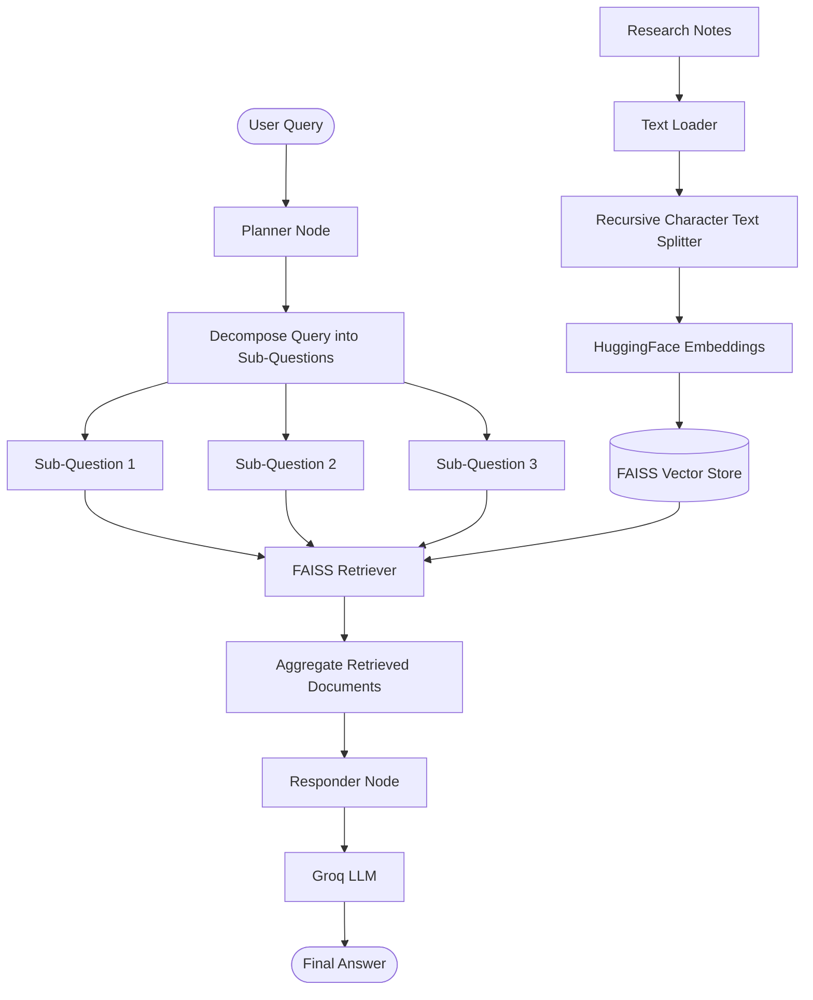

# 🧠 Chain of Thought RAG (CoT-RAG)

A Chain-of-Thought Retrieval-Augmented Generation (CoT-RAG) system built using **LangChain, LangGraph, FAISS, HuggingFace Embeddings, and Groq LLM**.

This project enhances traditional RAG by decomposing complex user queries into smaller reasoning steps, retrieving relevant documents for each sub-question, and synthesizing the retrieved information into a context-aware final answer.

## 🚀 Overview

Traditional RAG retrieves relevant documents directly from the original query. CoT-RAG introduces an intermediate planning stage that allows the system to break complex queries into manageable sub-questions.

### Key Features

- **Query Decomposition:** Breaks complex queries into 2–3 reasoning steps.
- **Step-wise Retrieval:** Retrieves relevant documents for every sub-question.
- **Semantic Search:** Uses HuggingFace embeddings and FAISS for vector-based retrieval.
- **Graph-based Workflow:** Orchestrates the pipeline using LangGraph.
- **Context-aware Generation:** Generates a final response using aggregated retrieved context.
- **Modular Architecture:** Planner, Retriever, and Responder nodes.

## 🏗️ Architecture



## 🔄 Workflow

1. **Document Loading:** Load research notes using `TextLoader`.
2. **Text Chunking:** Split documents into chunks using `RecursiveCharacterTextSplitter`.
3. **Embedding Generation:** Generate vector embeddings using `sentence-transformers/all-MiniLM-L6-v2`.
4. **Vector Store Creation:** Store document embeddings in FAISS.
5. **Query Planning:** The Planner Node decomposes the user's query into smaller sub-questions.
6. **Step-wise Retrieval:** The Retriever Node retrieves relevant documents for each sub-question.
7. **Context Aggregation:** Combine retrieved documents into a unified context.
8. **Answer Generation:** The Responder Node uses Groq LLM to generate the final answer.

## 🛠️ Tech Stack

| Technology | Purpose |
|---|---|
| Python | Core programming language |
| LangChain | LLM and retrieval integration |
| LangGraph | Workflow orchestration |
| FAISS | Vector similarity search |
| HuggingFace Embeddings | Semantic embedding generation |
| Sentence Transformers | `all-MiniLM-L6-v2` embedding model |
| Groq | LLM inference |
| Pydantic | State schema definition |
| Jupyter Notebook | Experimentation and development |

## 📂 Project Structure

```text
1-Chain of Thought/
│
├── 1-COTRag.ipynb
├── research_notes.txt
└── README.md
```

## ⚙️ Setup & Installation

### 1. Clone the Repository

```bash
git clone https://github.com/connectwithaadi/GenerativeAI-Learn.git
```

### 2. Navigate to the Project Directory

```bash
cd GenerativeAI-Learn/RAG/7-Autonomous%20RAG/1-Chain%20of%20Thought
```

### 3. Install Dependencies

```bash
pip install langchain langchain-community langchain-groq langchain-huggingface langchain-text-splitters langgraph faiss-cpu sentence-transformers pydantic python-dotenv
```

### 4. Configure Environment Variables

Create a `.env` file:

```env
GROQ_API_KEY=your_groq_api_key
```

Never commit your API key to GitHub.

### 5. Run the Notebook

Open `1-COTRag.ipynb` using Jupyter Notebook or VS Code and execute the cells sequentially.

## 🧪 Example Query

```python
query = "What are the additional experiments in Transformer Evaluation?"
```

### Expected Process

```text
User Query
   ↓
Planner → Generate Sub-Questions
   ↓
Retriever → Retrieve Relevant Documents
   ↓
Context Aggregation
   ↓
Groq LLM → Generate Final Answer
```

The system generates intermediate sub-questions and uses retrieved research information to produce a final response.

## 📚 Key Concepts Learned

- Chain-of-Thought prompting
- Query decomposition
- Retrieval-Augmented Generation
- Semantic vector search
- FAISS vector databases
- LangGraph StateGraph
- Pydantic-based state management
- Multi-step retrieval pipelines
- Context aggregation and answer synthesis

## 🔮 Future Improvements

- Add parallel retrieval for sub-questions.
- Implement document reranking.
- Add a reflection and answer-validation node.
- Introduce conditional edges for adaptive retrieval.
- Add source citations to generated answers.
- Implement retrieval quality evaluation.

## 👨‍💻 Author

**Aditya Kumar Singh**

- GitHub: [@connectwithaadi](https://github.com/connectwithaadi)

---

⭐ If you find this project useful, consider giving the repository a star!

