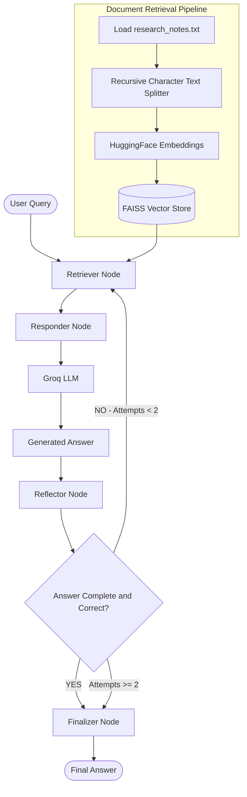

# 🪞 Self-Reflection RAG — LangGraph

An intelligent Retrieval-Augmented Generation (RAG) system that improves answer quality through **LLM-based self-evaluation, iterative retrieval, and conditional regeneration**.

Built using LangChain, LangGraph, FAISS, HuggingFace Embeddings, and Groq LLM.

## 🧠 Overview

Traditional RAG generates an answer after retrieving relevant documents. However, the generated answer may be incomplete or inaccurate.

Self-Reflection RAG introduces a dedicated reflection step where the LLM evaluates its own generated answer against the original question.

If the answer is unsatisfactory, the system retrieves context again and regenerates the response. The workflow terminates when the answer passes reflection or the maximum number of attempts is reached.

## ✨ Features

- **Semantic Retrieval:** Retrieves relevant documents using FAISS and HuggingFace embeddings.
- **LLM Answer Generation:** Generates context-aware answers using Groq.
- **Self-Critic Mechanism:** Evaluates answer completeness and correctness.
- **Conditional Workflow:** Dynamically decides whether to finish or retry.
- **Iterative Improvement:** Supports multiple answer-generation attempts.
- **LangGraph Orchestration:** Manages state transitions across retrieval, response, and reflection nodes.
- **Attempt Tracking:** Tracks the number of answer-generation attempts.

## 🏗️ Architecture Diagram



## 🔄 Workflow

1. **Document Loading:** Loads research notes using `TextLoader`.
2. **Text Chunking:** Splits the documents into chunks of 500 characters with 50-character overlap.
3. **Embedding Generation:** Generates semantic embeddings using HuggingFace Embeddings.
4. **Vector Store Creation:** Creates a FAISS vector store.
5. **Retrieval:** Fetches relevant documents based on the user's query.
6. **Answer Generation:** Groq LLM generates an answer using retrieved context.
7. **Self-Reflection:** The LLM evaluates the answer for completeness and correctness.
8. **Conditional Routing:**
   - YES → Proceed to finalization.
   - NO → Retrieve documents and regenerate the answer.
   - Maximum attempts reached → Finalize the current answer.
9. **Finalization:** Returns the final answer, reflection log, and attempt count.

## 🧩 LangGraph Nodes

| Node | Responsibility |
|---|---|
| `retriever` | Retrieves relevant documents from FAISS |
| `responder` | Generates an answer using retrieved context |
| `reflector` | Evaluates the generated answer |
| `done` | Finalizes the workflow |

## 📦 State Management

The workflow uses a Pydantic state model named `RAGReflectionState`.

| State Variable | Description |
|---|---|
| `question` | Original user query |
| `retrieved_docs` | Documents retrieved from FAISS |
| `answer` | Generated answer |
| `reflection` | Self-evaluation feedback |
| `revised` | Indicates whether the answer requires another attempt |
| `attempts` | Number of answer-generation attempts |

## 🛠️ Tech Stack

| Technology | Purpose |
|---|---|
| Python | Core programming language |
| LangChain | LLM and retrieval integration |
| LangGraph | Workflow orchestration |
| FAISS | Vector similarity search |
| HuggingFace Embeddings | Semantic embedding generation |
| Groq | LLM inference |
| Pydantic | State schema validation |
| Jupyter Notebook | Development and experimentation |

## 📂 Project Structure

```text
2-Self Reflection/
│
├── 2-Self-Reflection.ipynb
├── research_notes.txt
└── README.md
```

## ⚙️ Installation & Setup

### 1. Clone Repository

```bash
git clone https://github.com/connectwithaadi/GenerativeAI-Learn.git
```

### 2. Navigate to Project

```bash
cd GenerativeAI-Learn/RAG/7-Autonomous%20RAG/2-Self%20Reflection
```

### 3. Install Dependencies

```bash
pip install langchain langchain-classic langchain-community langchain-groq langchain-huggingface langgraph faiss-cpu sentence-transformers pydantic python-dotenv
```

### 4. Configure API Key

Create a `.env` file:

```env
GROQ_API_KEY=your_groq_api_key
```

Keep your API key private and never commit `.env` to GitHub.

### 5. Run the Notebook

Open `2-Self-Reflection.ipynb` using Jupyter Notebook or VS Code and execute the cells sequentially.

## 💡 Example Query

```python
user_query = "What are the transformer variants in production deployments?"
```

The system retrieves relevant research notes, generates an answer, evaluates it through the reflection node, and returns the final response.

## 📚 Key Concepts Learned

- Self-Reflection in RAG
- LLM-as-a-Critic
- Iterative Retrieval
- Conditional Edges in LangGraph
- StateGraph and State Management
- Pydantic Models
- Answer Quality Evaluation
- Feedback-driven Generation
- Autonomous RAG Workflows

## 🔮 Future Improvements

- Implement structured reflection output using Pydantic.
- Add a dedicated query-rewriting node.
- Implement answer grounding verification.
- Add document reranking.
- Track reflection scores across iterations.
- Integrate LangGraph checkpointing.
- Add human-in-the-loop review.
- Evaluate answer quality using RAGAS.

## 👨‍💻 Author

**Aditya Kumar Singh**

GitHub: [@connectwithaadi](https://github.com/connectwithaadi)

---

⭐ If you find this project useful, consider giving the repository a star!

