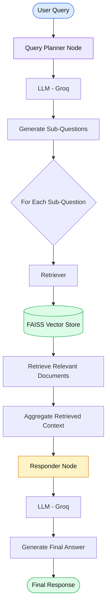

# 🧠 Query Planning & Decomposition — Autonomous RAG

An intelligent Retrieval-Augmented Generation (RAG) pipeline built using **LangChain, LangGraph, FAISS, and Groq LLMs**.

This project demonstrates how complex user queries can be decomposed into smaller sub-questions, retrieved independently from a vector database, and combined to generate a comprehensive final answer.

## 🚀 Overview

Query Planning and Decomposition is an autonomous RAG technique that enables an AI system to break down complex questions into manageable sub-queries before retrieving relevant information.

Instead of retrieving documents for the entire query at once, the system follows a structured approach:

- 🧠 **Query Planning:** Breaks complex queries into 2–3 sub-questions using an LLM.
- 🔍 **Multi-Query Retrieval:** Retrieves relevant documents for each sub-question.
- 📚 **Context Aggregation:** Combines the retrieved documents into a unified context.
- 🤖 **Answer Generation:** Generates a consolidated response using the original query and retrieved context.
- 🔗 **LangGraph Workflow:** Orchestrates the entire process through interconnected nodes.

## 🏗️ Architecture



## 🔄 Workflow

### 1. Document Ingestion

The system loads documents from the following research articles:

- [LLM Powered Autonomous Agents](https://lilianweng.github.io/posts/2023-06-23-agent/)
- [Diffusion Models for Video Generation](https://lilianweng.github.io/posts/2024-04-12-diffusion-video/)

Documents are processed using `RecursiveCharacterTextSplitter`.

| Parameter | Value |
|---|---|
| Chunk Size | 500 |
| Chunk Overlap | 50 |
| Embedding Model | all-MiniLM-L6-v2 |
| Vector Store | FAISS |

### 2. Query Planning

The Query Planner Node uses the Groq LLM to decompose the original complex question into 2–3 smaller sub-questions.

Example:

**Original Query:**

> Explain how agent loops work and what are the challenges in diffusion video generation?

**Possible Sub-Questions:**

- How do agent loops work in autonomous AI agents?
- What are the major challenges in diffusion video generation?
- How do iterative reasoning and generation processes operate?

### 3. Multi-Query Retrieval

Each sub-question is passed independently to the FAISS retriever.

The retrieved documents from all sub-questions are collected and aggregated into a shared context.

### 4. Final Answer Generation

The Responder Node combines:

- Original user query
- Retrieved document context

The Groq LLM generates a final consolidated response grounded in the retrieved information.

## 🛠️ Tech Stack

| Technology | Purpose |
|---|---|
| Python | Core programming language |
| LangChain | LLM and retrieval integration |
| LangGraph | Workflow orchestration |
| Groq | LLM inference |
| FAISS | Vector similarity search |
| HuggingFace Embeddings | Semantic document embeddings |
| Pydantic | State schema validation |
| WebBaseLoader | Web document ingestion |
| RecursiveCharacterTextSplitter | Document chunking |

## 📂 Project Structure

```text
3-QueryPlanningDecomposition/
│
├── 3-QueryPlanningDecomposition.ipynb
├── README.md
└── research_notes.txt
```

## ⚙️ Installation & Setup

### 1. Clone the Repository

```bash
git clone https://github.com/connectwithaadi/GenerativeAI-Learn.git
```

### 2. Navigate to the Project Directory

```bash
cd GenerativeAI-Learn/RAG/7-Autonomous-RAG/3-QueryPlanningDecomposition
```

### 3. Install Dependencies

```bash
pip install langchain langchain-community langchain-text-splitters langchain-groq langchain-huggingface langgraph faiss-cpu sentence-transformers python-dotenv beautifulsoup4
```

### 4. Configure Environment Variables

Create a `.env` file in the project directory.

```env
GROQ_API_KEY=your_groq_api_key
```

### 5. Run the Notebook

Open the Jupyter Notebook:

```bash
jupyter notebook 3-QueryPlanningDecomposition.ipynb
```

Execute the notebook cells sequentially.

## 🧪 Example

**Input:**

```text
Explain how agent loops work and what are the challenges
in diffusion video generation?
```

**Processing:**

```text
Complex Query
     ↓
Query Decomposition
     ↓
Sub-Question 1 → FAISS Retrieval
Sub-Question 2 → FAISS Retrieval
Sub-Question 3 → FAISS Retrieval
     ↓
Context Aggregation
     ↓
LLM Answer Generation
     ↓
Final Consolidated Answer
```

## 🎯 Learning Objectives

- Understand autonomous RAG architecture.
- Implement query decomposition using LLMs.
- Perform retrieval for multiple sub-questions.
- Build stateful workflows using LangGraph.
- Integrate Groq with LangChain.
- Improve retrieval coverage for complex queries.

## 🔮 Future Improvements

- Parallel retrieval using LangGraph.
- Add document reranking for improved relevance.
- Implement query rewriting and refinement.
- Add retrieval evaluation using Recall@K and MRR.
- Introduce iterative retrieval and self-correction.
- Add source citations to generated responses.

## 👨‍💻 Author

**Aditya Kumar Singh (Aadi)**

AI/ML Engineer | Generative AI | Agentic AI | RAG

- GitHub: [@connectwithaadi](https://github.com/connectwithaadi)

---

⭐ If you find this project useful, consider starring the repository!

