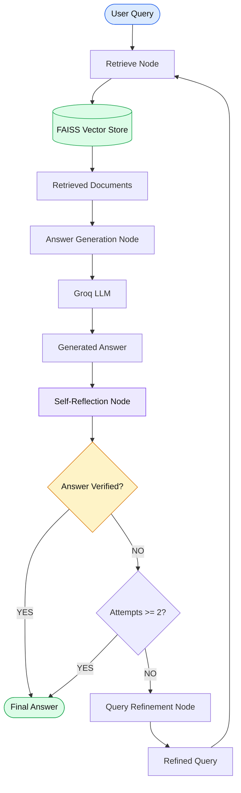

# 🔁 Iterative Retrieval — Autonomous RAG

An autonomous Retrieval-Augmented Generation (RAG) pipeline built using **LangChain, LangGraph, FAISS, HuggingFace Embeddings, and Groq LLMs**.

This project implements an iterative retrieval strategy where an AI system retrieves relevant documents, generates an answer, evaluates its completeness, and refines the query when the answer is insufficient.

## 🚀 Overview

Traditional RAG systems retrieve documents once and generate an answer. However, the initial retrieval may not provide enough context.

Iterative Retrieval addresses this limitation through a feedback loop:

- 🔍 **Retrieval:** Fetch relevant documents from the FAISS vector store.
- 🤖 **Answer Generation:** Generate an answer using retrieved context.
- 🧠 **Self-Reflection:** Evaluate whether the answer is factually sufficient and complete.
- ✍️ **Query Refinement:** Improve the query when the answer is incomplete.
- 🔁 **Iterative Execution:** Repeat retrieval and generation until verification succeeds or the maximum attempt limit is reached.

## 🏗️ Architecture



## 🔄 Workflow

### 1. Document Ingestion

The system loads research notes using `TextLoader`.

Documents are split into smaller chunks and converted into embeddings before being stored in FAISS.

| Parameter | Value |
|---|---|
| Document Loader | TextLoader |
| Chunk Size | 500 |
| Chunk Overlap | 50 |
| Embedding Model | all-MiniLM-L6-v2 |
| Vector Store | FAISS |

### 2. Retrieve Node

The retriever searches the FAISS vector store using the original query or refined query.

Relevant documents are returned to provide context for answer generation.

### 3. Answer Generation

The Groq LLM generates an answer using:

- Retrieved document context
- Original user question

The generated answer and attempt count are stored in the agent state.

### 4. Self-Reflection

The Reflection Node evaluates whether the generated answer is factually sufficient and complete.

It returns a verification result:

- `YES` — The answer is considered complete.
- `NO` — The answer requires additional context.

### 5. Query Refinement

If the answer is incomplete, the Query Refinement Node generates an improved retrieval query using the original question and current answer.

The refined query is passed back to the Retrieve Node.

### 6. Termination

The workflow terminates when:

- The answer is verified.
- The maximum attempt limit of 2 is reached.

The final generated answer is returned along with its verification status and attempt count.

## 🧠 LangGraph State

The workflow uses a Pydantic state model.

| State Variable | Description |
|---|---|
| `question` | Original user query |
| `refined_question` | Improved query for retrieval |
| `retrieved_docs` | Documents retrieved from FAISS |
| `answer` | Generated response |
| `verified` | Answer verification status |
| `attempts` | Number of answer-generation attempts |

## 🛠️ Tech Stack

| Technology | Purpose |
|---|---|
| Python | Core programming language |
| LangChain | LLM and retrieval integration |
| LangGraph | Stateful workflow orchestration |
| Groq | LLM inference |
| FAISS | Vector similarity search |
| HuggingFace Embeddings | Semantic document embeddings |
| Pydantic | State management and validation |
| RecursiveCharacterTextSplitter | Document chunking |
| python-dotenv | Environment variable management |

## 📂 Project Structure

```text
4-IterativeRetrieval/
│
├── 4-IterativeRetrieval.ipynb
├── README.md
└── research_notes.txt
```

## ⚙️ Installation & Setup

### 1. Clone the Repository

```bash
git clone https://github.com/connectwithaadi/GenerativeAI-Learn.git
```

### 2. Navigate to the Project Directory

```bash
cd GenerativeAI-Learn/RAG/7-Autonomous-RAG/4-IterativeRetrieval
```

### 3. Install Dependencies

```bash
pip install langchain langchain-community langchain-text-splitters langchain-groq langchain-huggingface langgraph faiss-cpu sentence-transformers pydantic python-dotenv
```

### 4. Configure Environment Variables

Create a `.env` file in the project directory.

```env
GROQ_API_KEY=your_groq_api_key
```

### 5. Run the Notebook

```bash
jupyter notebook 4-IterativeRetrieval.ipynb
```

Execute the notebook cells sequentially.

## 🧪 Example

**Input Query:**

```text
agent loops and transformer-based systems?
```

**Processing:**

```text
User Query
    ↓
Initial Retrieval
    ↓
Answer Generation
    ↓
Self-Reflection
    ↓
Answer Incomplete?
    ↓
Query Refinement
    ↓
Retrieve Again
    ↓
Generate Improved Answer
    ↓
Verification / Maximum Attempts
    ↓
Final Answer
```

## 🎯 Learning Objectives

- Understand iterative retrieval in Agentic RAG.
- Implement self-reflection and answer verification.
- Build query refinement mechanisms.
- Create feedback loops using LangGraph.
- Manage agent state using Pydantic.
- Improve retrieval coverage through repeated search.
- Implement conditional routing and termination.

## 🔮 Future Improvements

- Add a relevance grading node for retrieved documents.
- Implement adaptive retrieval stopping criteria.
- Add document reranking.
- Introduce hallucination detection.
- Track retrieval quality using Recall@K and MRR.
- Add source citations to generated answers.
- Implement parallel retrieval for refined queries.

## 👨‍💻 Author

**Aditya Kumar Singh (Aadi)**


- GitHub: [@connectwithaadi](https://github.com/connectwithaadi)

---

⭐ If you find this project useful, consider starring the repository!

