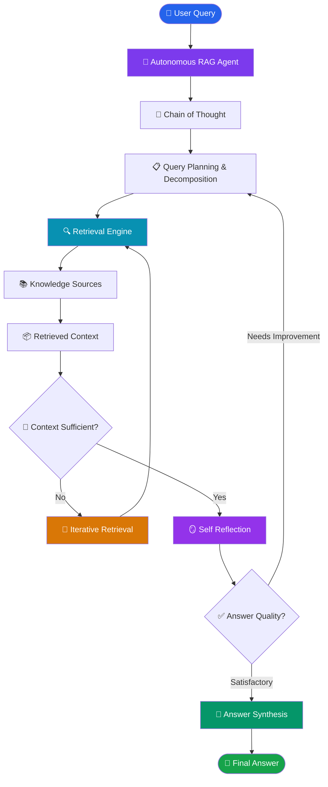

# 🤖 Autonomous RAG — Advanced Retrieval-Augmented Generation

An advanced exploration of **Autonomous Retrieval-Augmented Generation (RAG)** systems that combine intelligent retrieval, reasoning, planning, self-reflection, and answer synthesis to solve complex knowledge-intensive tasks.

This module explores how RAG systems can move beyond static retrieval pipelines toward more adaptive and intelligent workflows using LLMs and agentic architectures.

## 🎯 Overview

Traditional RAG follows a fixed pipeline:

`Query → Retrieval → Context → Generation`

Autonomous RAG introduces reasoning and decision-making capabilities that allow a system to improve how it retrieves, processes, and synthesizes information.

This learning module focuses on five fundamental concepts:

- Chain of Thought
- Self Reflection
- Query Planning & Decomposition
- Iterative Retrieval
- Answer Synthesis

## 🏗️ Autonomous RAG Architecture



## 📚 Learning Modules

| Module | Concept | Description | Resources |
|---|---|---|---|
| 1 | [Chain of Thought](./1-Chain%20of%20Thought/) | Explore reasoning-oriented approaches for complex queries. | [README](./1-Chain%20of%20Thought/README.md) · [Notebook](./1-Chain%20of%20Thought/1-COTRag.ipynb) |
| 2 | [Self Reflection](./2-Self%20Reflection/) | Improve answer quality through evaluation and refinement. | [README](./2-Self%20Reflection/README.md) · [Notebook](./2-Self%20Reflection/2-Self-Reflection.ipynb) |
| 3 | [Query Planning & Decomposition](./3-Query%20Planning%20Decomposition/) | Break complex questions into smaller, manageable sub-queries. | [README](./3-Query%20Planning%20Decomposition/README.md) · [Notebook](./3-Query%20Planning%20Decomposition/3-QueryPlanningDecomposition.ipynb) |
| 4 | [Iterative Retrieval](./4-Iterative%20Retrieval/) | Retrieve additional information when the initial context is insufficient. | [README](./4-Iterative%20Retrieval/README.md) · [Notebook](./4-Iterative%20Retrieval/4-IterativeRetrieval.ipynb) |
| 5 | [Answer Synthesis](./5-Answer%20Synthesis/) | Combine information from multiple sources into a coherent response. | [README](./5-Answer%20Synthesis/README.md) · [Notebook](./5-Answer%20Synthesis/5-AnswerSynthesis.ipynb) |


## 📂 Project Structure

```text
2-Autonomous RAG/
│
├── 1-Chain of Thought/
│   ├── 1-COTRag.ipynb
│   ├── research_notes.txt
│   └── README.md
│
├── 2-Self Reflection/
│   ├── 2-Self-Reflection.ipynb
│   ├── research_notes.txt
│   └── README.md
│
├── 3-Query Planning Decomposition/
│   ├── 3-QueryPlanningDecomposition.ipynb
│   ├── research_notes.txt
│   └── README.md
│
├── 4-Iterative Retrieval/
│   ├── 4-IterativeRetrieval.ipynb
│   ├── research_notes.txt
│   └── README.md
│
├── 5-Answer Synthesis/
│   ├── 5-AnswerSynthesis.ipynb
│   ├── research_notes.txt
│   └── README.md
│
├── rag-architecture-diagram.svg
└── README.md
```

## 🛠️ Technologies & Concepts

- Python
- LangChain
- LangGraph
- Large Language Models (LLMs)
- Retrieval-Augmented Generation (RAG)
- Semantic Search
- Vector Databases
- Query Decomposition
- Iterative Retrieval
- Self-Reflection
- Context Aggregation

## 🔄 Autonomous RAG Workflow

1. **Query Understanding:** Analyze the user query and identify its complexity.
2. **Reasoning:** Determine the information required to answer the query.
3. **Query Planning:** Decompose complex questions into smaller sub-queries.
4. **Retrieval:** Fetch relevant information from knowledge sources.
5. **Iterative Retrieval:** Retrieve additional context when necessary.
6. **Self-Reflection:** Evaluate the retrieved information and generated response.
7. **Answer Synthesis:** Combine relevant context into a coherent answer.
8. **Final Response:** Deliver the synthesized response to the user.

## 🎓 Learning Objectives

By completing this module, you will understand:

- How autonomous RAG differs from traditional RAG.
- How reasoning can guide retrieval workflows.
- How to decompose complex queries.
- How iterative retrieval improves context coverage.
- How self-reflection can help refine generated answers.
- How to synthesize information from multiple sources.
- How agentic workflows can be orchestrated using LangGraph.

## 🔮 Future Enhancements

- Implement a supervisor-based Autonomous RAG architecture.
- Integrate multiple specialized retrieval agents.
- Introduce hybrid retrieval with BM25 and vector search.
- Add relevance-based reranking.
- Implement confidence-based retrieval decisions.
- Integrate SQL databases and real-time APIs.
- Add source-grounded answer evaluation.
- Optimize retrieval latency and token usage.

## 👨‍💻 Author

**Aditya Kumar Singh (Aadi)**

AI/ML Engineer | Generative AI | Agentic AI | RAG Systems

GitHub: [@connectwithaadi](https://github.com/connectwithaadi)

---

⭐ This repository documents my learning journey toward building advanced Generative AI and Autonomous AI Agent systems.

