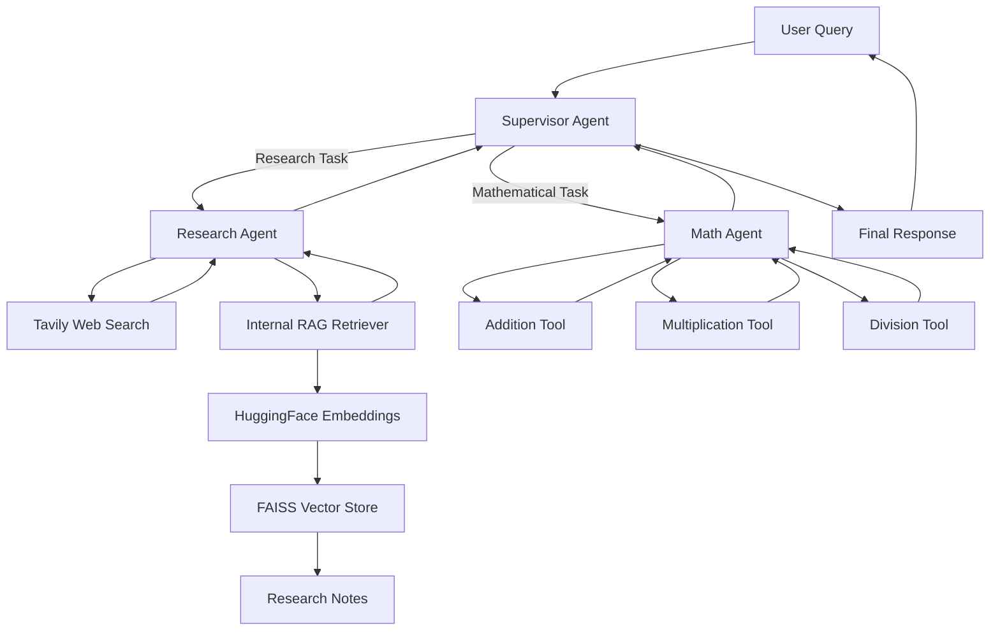

# Supervisor Multi-Agent RAG

A Supervisor-based Multi-Agent RAG system built using **LangGraph, LangChain, Groq, FAISS, HuggingFace Embeddings, and Tavily Search**.

This project demonstrates how a central Supervisor Agent coordinates specialized AI agents to solve complex tasks through intelligent task delegation. The system combines internal knowledge retrieval, web research, and mathematical computation in a unified workflow.

## Overview

A single AI agent can become less effective when handling multiple unrelated tasks. A Supervisor Multi-Agent architecture addresses this limitation by assigning tasks to specialized agents based on their capabilities.

In this implementation, the Supervisor manages two specialized agents:

- **Research Agent:** Performs research-related tasks using web search and internal knowledge retrieval.
- **Math Agent:** Handles mathematical computations using dedicated arithmetic tools.
- **Supervisor Agent:** Analyzes the user's request, delegates tasks to the appropriate agent, and manages communication between agents.

## Architecture



## Key Features

- Supervisor-based multi-agent orchestration
- Specialized Research and Math Agents
- Agent-to-agent task delegation
- Retrieval-Augmented Generation using internal research notes
- Semantic search with HuggingFace embeddings
- FAISS-based vector retrieval
- Web research using Tavily Search
- Tool calling for arithmetic operations
- LangGraph-based agent workflow
- Combined research and mathematical reasoning in a single query

## Tech Stack

| Technology | Purpose |
|---|---|
| Python | Core programming language |
| LangChain | Agent and tool development |
| LangGraph | Agent workflow orchestration |
| LangGraph Supervisor | Supervisor-based delegation |
| Groq | LLM inference |
| GPT-OSS 120B | Language model |
| HuggingFace | Text embeddings |
| Sentence Transformers | Embedding model |
| FAISS | Vector storage and retrieval |
| Tavily | Web search |
| RecursiveCharacterTextSplitter | Document chunking |
| dotenv | Environment variable management |

## Agents

### 1. Research Agent

The Research Agent specializes in information retrieval and research tasks.

**Tools:**
- Tavily Web Search
- Internal Research Notes Retriever

The internal retriever uses FAISS to search relevant information from the research notes.

### 2. Math Agent

The Math Agent specializes in numerical calculations.

**Tools:**
- Addition
- Multiplication
- Division

Mathematical operations are handled through Python functions instead of relying solely on LLM-generated calculations.

### 3. Supervisor Agent

The Supervisor acts as the central orchestrator.

Responsibilities:
- Understand the user's query
- Identify the required task type
- Route tasks to specialized agents
- Manage agent communication
- Receive agent responses
- Return the final response

The current implementation assigns work to one agent at a time.

## RAG Pipeline

The internal knowledge retrieval pipeline follows these steps:

1. Load research notes using `TextLoader`.
2. Split documents into chunks using `RecursiveCharacterTextSplitter`.
3. Generate embeddings using `all-MiniLM-L6-v2`.
4. Store document embeddings in FAISS.
5. Retrieve relevant chunks based on the research query.
6. Provide retrieved context to the Research Agent.

### Configuration

| Parameter | Value |
|---|---|
| Embedding Model | `sentence-transformers/all-MiniLM-L6-v2` |
| Chunk Size | 500 |
| Chunk Overlap | 50 |
| Vector Store | FAISS |
| Web Search Results | 3 |
| LLM | `openai/gpt-oss-120b` |
| Temperature | 0 |

## Project Structure

```text
2-Supervisor-Multi-Agent-RAG/
│
├── README.md
├── supervisor_multiagent.ipynb
└── research_notes.txt
```

## Installation and Setup

### 1. Clone the Repository

```bash
git clone https://github.com/connectwithaadi/GenerativeAI-Learn.git
cd GenerativeAI-Learn
```

Navigate to the project directory:

```bash
cd "Advance RAG/3-Multi Agents RAG/2-Supervisor Multi-Agent RAG"
```

### 2. Install Dependencies

Install the required packages:

```bash
pip install langchain
pip install langchain-groq
pip install langgraph
pip install langgraph-supervisor
pip install langchain-tavily
pip install langchain-community
pip install langchain-huggingface
pip install langchain-text-splitters
pip install faiss-cpu
pip install sentence-transformers
pip install python-dotenv
```

### 3. Configure Environment Variables

Create a `.env` file in the project directory.

```env
GROQ_API_KEY=your_groq_api_key
TAVILY_API_KEY=your_tavily_api_key
```

Obtain API keys from:

- [Groq Console](https://console.groq.com/)
- [Tavily](https://tavily.com/)

Never commit your `.env` file to GitHub.

### 4. Run the Notebook

Open the notebook:

```bash
jupyter notebook supervisor_multiagent.ipynb
```

Execute the notebook cells sequentially to initialize the model, tools, agents, and Supervisor workflow.

## Example Usage

```python
response = supervisor.invoke({
    "messages": (
        "List transformer variants in production deployments "
        "from the retriever and then tell me what is 5 plus 10."
    )
})

print(response["messages"][-1].content)
```

### Workflow

1. The Supervisor receives the user query.
2. The Research Agent retrieves transformer-related information from internal research notes.
3. The Math Agent calculates the requested sum.
4. The Supervisor receives the outputs and returns the response.

This demonstrates how multiple specialized agents can collaborate to solve a compound query.

## Learning Objectives

By completing this project, you will understand:

- Multi-Agent System Architecture
- Supervisor-based Agent Orchestration
- Task Delegation and Routing
- Agent Specialization
- Tool Calling
- Retrieval-Augmented Generation
- FAISS Vector Search
- LangGraph Agent Workflows
- Combining RAG with Multi-Agent Systems

## Future Improvements

- Add more specialized agents
- Implement parallel agent execution
- Introduce a structured state management system
- Add conversation memory
- Implement agent-level error handling
- Add evaluation metrics for routing accuracy and retrieval quality
- Build a Streamlit interface
- Integrate SQL and external APIs as additional retrieval tools

## References

- [LangGraph Documentation](https://docs.langchain.com/oss/python/langgraph/overview)
- [LangChain Documentation](https://docs.langchain.com/oss/python/langchain/overview)
- [LangGraph Supervisor](https://github.com/langchain-ai/langgraph-supervisor)
- [FAISS Documentation](https://github.com/facebookresearch/faiss)
- [HuggingFace](https://huggingface.co/)
- [Tavily](https://docs.tavily.com/)

---

**Author:** Aditya Kumar Singh

**GitHub:** [connectwithaadi](https://github.com/connectwithaadi)
