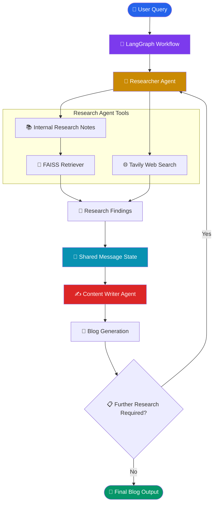

# 🤖 Multi-Agent Network — Collaborative AI Agents

A collaborative **Multi-Agent AI System** built using LangGraph and LangChain, where specialized AI agents work together to perform research and generate high-quality content.

Instead of relying on a single LLM agent, this project follows a divide-and-conquer approach. Each agent is assigned a specific responsibility, enabling better task specialization, collaboration, and workflow orchestration.

## 🎯 Project Overview

This project implements a multi-agent network consisting of:

- **Researcher Agent:** Collects relevant information using internal research notes and web search.
- **Content Writer Agent:** Generates detailed, structured blog content using the researcher's findings.
- **LangGraph Workflow:** Orchestrates agent execution and manages collaboration through a shared message state.

### Key Features

- Specialized AI agents with distinct responsibilities.
- Internal knowledge retrieval using FAISS.
- External information gathering using Tavily Search.
- Collaborative agent communication.
- LLM-powered content generation.
- Graph-based workflow orchestration using LangGraph.

## 🏗️ Architecture



> The architecture diagram represents the intended collaboration workflow. The research-to-writer flow is implemented in the notebook; conditional research iteration can be developed as an enhancement.

## 🔄 Workflow

1. **User Input:** The user submits a task or topic for content generation.
2. **Research:** The Researcher Agent analyzes the task and identifies relevant information.
3. **Knowledge Retrieval:** Internal research notes are searched using FAISS.
4. **Web Research:** Tavily Search retrieves relevant external information.
5. **Context Sharing:** Research findings are shared through LangGraph's message state.
6. **Content Generation:** The Content Writer Agent uses the collected information to generate a detailed blog.
7. **Collaboration:** Agents can exchange information to improve the final deliverable.
8. **Final Output:** A comprehensive blog is returned to the user.

## 🛠️ Technology Stack

| Technology | Purpose |
|---|---|
| Python | Core programming language |
| LangChain | LLM and tool integration |
| LangGraph | Multi-agent workflow orchestration |
| Groq | LLM inference |
| FAISS | Vector-based knowledge retrieval |
| HuggingFace Embeddings | Text embedding generation |
| Tavily Search | Web research |
| Wikipedia | Potential external knowledge source |

## 📂 Project Structure

```text
3-Multi Agents RAG/
│
├── 1-Multi Agent Network/
│   ├── multiagent.ipynb
│   ├── research_notes.txt
│   └── README.md
│
└── README.md
```

## 🎓 Learning Objectives

- Understand Multi-Agent AI architectures.
- Build specialized agents using LangGraph.
- Implement collaborative agent workflows.
- Integrate internal RAG with external web search.
- Share context between agents using graph state.
- Understand the divide-and-conquer approach to AI systems.
- Explore agent collaboration and workflow orchestration.

## 🚀 Future Enhancements

- Introduce a Supervisor Agent for dynamic task routing.
- Implement a dedicated Self-Reflection Agent.
- Add iterative research and content refinement.
- Integrate hybrid retrieval using BM25 and FAISS.
- Add source citation and fact verification.
- Implement agent execution monitoring and tracing.
- Introduce conditional routing and retry mechanisms.

## 👨‍💻 Author

**Aditya Kumar Singh (Aadi)**

AI/ML Engineer | Generative AI | Agentic AI | RAG Systems

GitHub: [@connectwithaadi](https://github.com/connectwithaadi)

---

⭐ This project is part of my Generative AI and Agentic AI learning journey.

