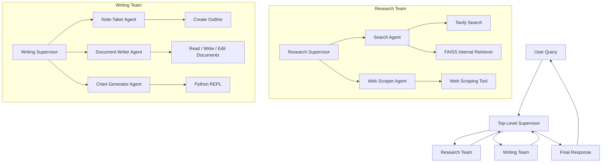

# Hierarchical Agents with RAG

A Hierarchical Multi-Agent RAG system built using **LangGraph, LangChain, Groq, FAISS, HuggingFace Embeddings, and Tavily Search**.

This project demonstrates how complex AI tasks can be distributed across multiple levels of agent supervision. Instead of managing every worker through a single supervisor, the system uses a top-level Supervisor Agent and specialized mid-level supervisors to coordinate dedicated worker agents.

## Overview

As multi-agent systems grow in complexity, a single supervisor may become inefficient at managing a large number of specialized workers.

Hierarchical Agent Architecture addresses this challenge by organizing agents into multiple levels:

- **Top-Level Supervisor:** Coordinates the overall workflow and delegates tasks to specialized teams.
- **Research Team:** Performs web research, internal knowledge retrieval, and webpage scraping.
- **Writing Team:** Handles document planning, writing, editing, and chart generation.
- **Worker Agents:** Execute specific tasks using their dedicated tools.

The architecture follows a divide-and-conquer approach to handle complex research and document-generation tasks.

## Architecture



## Key Features

- Hierarchical Multi-Agent Orchestration
- Top-Level and Mid-Level Supervisors
- Specialized Research and Writing Teams
- Dynamic Task Delegation
- Internal Knowledge Retrieval using RAG
- Semantic Search using FAISS
- Web Search using Tavily
- Webpage Scraping using WebBaseLoader
- Automated Document Outline Generation
- AI-Powered Document Writing and Editing
- Python-Based Chart Generation
- LangGraph Subgraph Composition

## Tech Stack

| Technology | Purpose |
|---|---|
| Python | Core programming language |
| LangChain | Agent creation and tool integration |
| LangGraph | Hierarchical workflow orchestration |
| Groq | LLM inference |
| GPT-OSS 120B | Language model |
| HuggingFace Embeddings | Semantic embeddings |
| Sentence Transformers | Embedding model |
| FAISS | Vector store |
| Tavily Search | Web research |
| WebBaseLoader | Webpage scraping |
| LangGraph ReAct Agent | Worker agent implementation |
| PythonREPL | Python code execution |
| LangChain Experimental | PythonREPL integration |

## Agent Architecture

### 1. Top-Level Supervisor

The central orchestrator of the complete system.

Responsibilities:
- Understand user requests
- Select the appropriate specialized team
- Delegate tasks to the Research Team or Writing Team
- Receive team-level outputs
- Coordinate the overall workflow
- Return the final response

### 2. Research Team

The Research Team is controlled by its own Research Supervisor.

#### Research Supervisor

Routes research tasks to specialized workers.

#### Search Agent

Tools:
- Tavily Search
- Internal FAISS Retriever

The Search Agent can retrieve information from the web and internal research notes.

#### Web Scraper Agent

Tool:
- `scrape_webpages`

Uses `WebBaseLoader` to extract webpage content for detailed research.

### 3. Writing Team

The Writing Team is controlled by a separate Writing Supervisor.

#### Note-Taker Agent

Tools:
- `create_outline`
- `read_document`

Creates structured outlines for document generation.

#### Document Writer Agent

Tools:
- `write_document`
- `edit_document`
- `read_document`

Creates and edits documents based on the outlines generated by the Note-Taker Agent.

#### Chart Generator Agent

Tools:
- `read_document`
- `python_repl_tool`

Uses Python execution to generate charts and perform code-based tasks.

## RAG Pipeline

The Research Team uses an internal Retrieval-Augmented Generation pipeline.

1. Load internal research notes using `TextLoader`.
2. Split documents into chunks using `RecursiveCharacterTextSplitter`.
3. Generate embeddings using `all-MiniLM-L6-v2`.
4. Store embeddings in FAISS.
5. Retrieve relevant chunks using semantic similarity.
6. Provide retrieved context to the Search Agent.

### RAG Configuration

| Parameter | Value |
|---|---|
| Embedding Model | `sentence-transformers/all-MiniLM-L6-v2` |
| Chunk Size | 500 |
| Chunk Overlap | 50 |
| Vector Store | FAISS |
| Web Search Results | 5 |
| LLM | `openai/gpt-oss-120b` |
| Temperature | 0 |

## Project Structure

```text
3-Hierarchical Agents with RAG/
│
├── README.md
├── hierarchical_agent.ipynb
└── research_notes.txt
```

## Installation and Setup

### 1. Clone the Repository

```bash
git clone https://github.com/connectwithaadi/GenerativeAI-Learn.git
cd GenerativeAI-Learn
```

Navigate to the project directory:

```bash
cd "Advance RAG/3-Multi Agents RAG/3-Hierarchical Agents with RAG"
```

### 2. Install Dependencies

```bash
pip install langchain
pip install langchain-groq
pip install langgraph
pip install langchain-tavily
pip install langchain-community
pip install langchain-huggingface
pip install langchain-text-splitters
pip install langchain-experimental
pip install faiss-cpu
pip install sentence-transformers
pip install python-dotenv
pip install beautifulsoup4
pip install requests
```

### 3. Configure Environment Variables

Create a `.env` file:

```env
GROQ_API_KEY=your_groq_api_key
TAVILY_API_KEY=your_tavily_api_key
```

API Keys:

- [Groq Console](https://console.groq.com/)
- [Tavily](https://tavily.com/)

Never commit API keys or `.env` files to GitHub.

### 4. Run the Notebook

```bash
jupyter notebook hierarchical_agent.ipynb
```

Execute the notebook cells sequentially to initialize the LLM, tools, agents, subgraphs, and hierarchical workflow.

## Example Usage

```python
response = super_graph.invoke(
    {
        "messages": [
            (
                "user",
                "Write about one transformer variant in production deployments in short."
            )
        ]
    }
)

print(response["messages"][-1].content)
```

### Execution Workflow

1. The User submits a research and writing request.
2. The Top-Level Supervisor routes the task to the appropriate team.
3. The Research Team gathers relevant information using web search and internal RAG.
4. The Writing Team creates an outline and generates the requested content.
5. Specialized worker agents execute their assigned subtasks.
6. Team supervisors report results to the Top-Level Supervisor.
7. The Top-Level Supervisor returns the final output.

## Learning Objectives

- Hierarchical Multi-Agent Architecture
- Multi-Level Agent Supervision
- LangGraph Subgraph Composition
- Supervisor-Based Task Delegation
- Agent Specialization
- Retrieval-Augmented Generation
- Vector Search with FAISS
- Tool Calling
- ReAct Agents
- Automated Document Generation
- Multi-Agent Workflow Design

## Future Improvements

- Implement parallel execution of worker agents
- Add persistent conversation memory
- Integrate additional specialized teams
- Add agent-level observability and tracing
- Implement robust error handling and retry mechanisms
- Add evaluation metrics for research quality
- Develop a Streamlit-based user interface
- Add persistent document storage

## References

- [LangGraph Documentation](https://docs.langchain.com/oss/python/langgraph/overview)
- [LangChain Documentation](https://docs.langchain.com/oss/python/langchain/overview)
- [LangGraph Supervisor](https://github.com/langchain-ai/langgraph-supervisor)
- [FAISS](https://github.com/facebookresearch/faiss)
- [HuggingFace](https://huggingface.co/)
- [Tavily Documentation](https://docs.tavily.com/)

---

**Author:** Aditya Kumar Singh

**GitHub:** [connectwithaadi](https://github.com/connectwithaadi)

