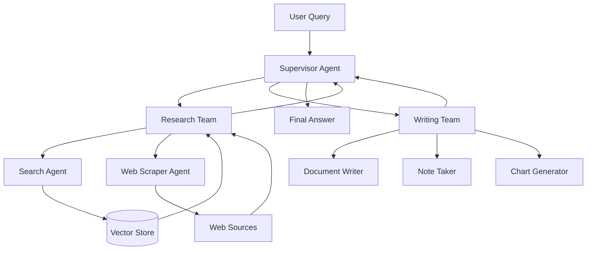

# 🤖 Multi-Agent RAG Systems

A learning module focused on building advanced Retrieval-Augmented Generation (RAG) systems using multiple specialized AI agents. This module explores how agents collaborate, delegate tasks, retrieve knowledge, and solve complex problems through coordinated workflows.

## 📚 Learning Modules

| # | Concept | Description | Notebook |
|---|---|---|---|
| 1 | Multi-Agent Network | Understand how multiple specialized agents collaborate and communicate to solve complex tasks. | [multagent.ipynb](./1-Multi%20Agent%20Network/multiagent.ipynb) |
| 2 | Supervisor Multi-Agent RAG | Learn how a central supervisor agent routes tasks to specialized worker agents and manages execution. | [supervisor_multiagent.ipynb](./2-Supervisor%20Multi-Agent%20RAG/supervisor_multiagent.ipynb) |
| 3 | Hierarchical Agents with RAG | Explore hierarchical agent architectures using nested supervisors and specialized subgraphs. | [hierarchical_agent.ipynb](./3-Hierachical%20Agents%20with%20RAG/hierarchical_agent.ipynb) |

## 🧠 Concepts Covered

### 1. Multi-Agent Network
- Specialized agents working together.
- Agent-to-agent communication.
- Task distribution and collaboration.
- Divide-and-conquer problem solving.
- Tool calling and knowledge retrieval.

### 2. Supervisor Multi-Agent RAG
- Central supervisor architecture.
- Intelligent task routing.
- Worker agent specialization.
- Shared state and communication flow.
- Retrieval-enabled worker agents.
- Dynamic task delegation.

### 3. Hierarchical Agents with RAG
- Hierarchical multi-agent architecture.
- Top-level and mid-level supervisors.
- Subgraph composition.
- Nested agent teams.
- Distributed task execution.
- Scalable research and document workflows.

## 🏗️ Architecture Overview

## 🎯 Learning Objectives

By completing this module, you will understand how to:

- Design collaborative multi-agent systems.
- Build supervisor-based agent workflows.
- Integrate RAG into specialized worker agents.
- Implement intelligent routing and task delegation.
- Compose hierarchical agent architectures.
- Build scalable AI research and knowledge assistants.

## 🛠️ Technologies

- Python
- LangChain
- LangGraph
- Large Language Models (LLMs)
- Retrieval-Augmented Generation (RAG)
- Vector Databases
- Tool Calling
- Multi-Agent Orchestration

## 🚀 Learning Path

1. Understand the fundamentals of multi-agent collaboration.
2. Build a Multi-Agent Network.
3. Implement a Supervisor Multi-Agent RAG architecture.
4. Develop Hierarchical Agents with RAG.
5. Experiment with specialized agents and retrieval workflows.
6. Apply these architectures to real-world AI applications.

## 💡 Real-World Applications

- AI Research Assistants
- Enterprise Knowledge Assistants
- Autonomous Document Generation
- Multi-Agent Customer Support
- Financial Analysis Agents
- Agentic RAG Systems
- Complex Workflow Automation

## 📖 References

- [LangGraph Documentation](https://docs.langchain.com/oss/python/langgraph/overview)
- [LangChain Documentation](https://docs.langchain.com/oss/python/langchain/overview)
- [LangGraph Multi-Agent Concepts](https://docs.langchain.com/oss/python/langgraph/concepts/multi_agent)

---
## 👨‍💻 Author

**Aditya Kumar Singh**

GitHub: [@connectwithaadi](https://github.com/connectwithaadi)

---

⭐ This project is part of my Generative AI and Agentic AI learning journey.

Learning and implementing advanced RAG and multi-agent AI architectures.

