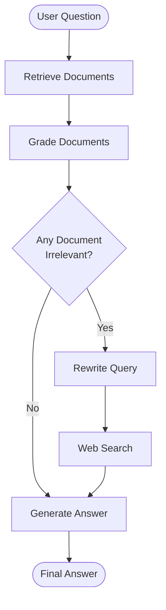

# 🔄 Corrective RAG (CRAG)

Corrective Retrieval-Augmented Generation (CRAG) is an advanced RAG technique that improves answer accuracy and relevance by evaluating retrieved documents and applying corrective actions when necessary.

Unlike traditional RAG, Corrective RAG introduces a retrieval evaluator that grades the quality of retrieved documents. If the documents are irrelevant or insufficient, the system rewrites the query and performs web search to obtain better information.

## 📚 Learning Module

| # | Concept | Resource |
|---|---|---|
| 1 | Corrective RAG (CRAG) | [📓 Open Notebook](./corrective_rag.ipynb) |
| 2 | Research Material | [📄 Corrective RAG Research PDF](./37.1-Corrective%2BRAGs.pdf) |

## 🧠 Key Concepts

- Retrieval Evaluation
- Document Relevance Grading
- Self-Reflection and Self-Grading
- Query Rewriting
- Corrective Retrieval
- Web Search Integration
- Conditional Routing
- LangGraph StateGraph
- Retrieval-Augmented Generation

## 🏗️ Architecture

## ⚙️ Workflow

1. **Retrieve:** Fetch relevant documents from the vector database.
2. **Grade Documents:** Evaluate the relevance of retrieved documents using an LLM-based retrieval grader.
3. **Decision:** Determine whether the retrieved documents are relevant to the question.
4. **Query Rewriting:** Transform the original query into an improved query optimized for web search.
5. **Web Search:** Retrieve additional information using Tavily Search.
6. **Generate:** Generate the final answer using the available context.

## 🛠️ Tech Stack

| Technology | Purpose |
|---|---|
| Python | Core programming language |
| LangChain | LLM and retrieval components |
| LangGraph | Workflow orchestration |
| Groq | LLM inference |
| FAISS | Vector storage and similarity search |
| HuggingFace Embeddings | Document embedding generation |
| Tavily | Web search integration |
| Pydantic | Structured output for document grading |

## 🎯 Learning Objectives

By completing this module, you will learn how to:

- Identify irrelevant retrieved documents.
- Improve retrieval quality through relevance grading.
- Implement query rewriting for better search results.
- Integrate web search into a RAG pipeline.
- Build conditional workflows using LangGraph.
- Improve the reliability of RAG-generated answers.

## 🚀 Benefits of Corrective RAG

- **Improved Accuracy:** Evaluates retrieved information before generating answers.
- **Enhanced Relevance:** Filters irrelevant documents.
- **Increased Robustness:** Handles imperfect initial retrieval.
- **Better Retrieval:** Uses query rewriting and web search when necessary.

## 📖 References

- [LangGraph Documentation](https://docs.langchain.com/oss/python/langgraph/overview)
- [LangChain Documentation](https://docs.langchain.com/oss/python/langchain/overview)
- [Tavily Documentation](https://docs.tavily.com/)

---

## 👨‍💻 Author

**Aditya Kumar Singh**

GitHub: [@connectwithaadi](https://github.com/connectwithaadi)

---

⭐ This project is part of my Generative AI and Agentic AI learning journey.

Learning and implementing advanced Retrieval-Augmented Generation architectures.

