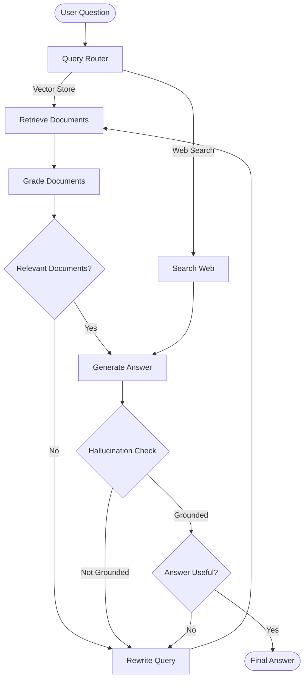

# 🧠 Adaptive RAG (Retrieval-Augmented Generation)

Adaptive RAG is an advanced Retrieval-Augmented Generation (RAG) strategy that dynamically selects the most appropriate retrieval approach based on the user's query.

Instead of using a fixed retrieval pipeline for every question, Adaptive RAG analyzes the query and intelligently routes it to the relevant knowledge source, such as a vector store or web search.

It combines **Query Analysis, Retrieval Grading, Self-Reflection, and Query Rewriting** to improve answer relevance, accuracy, and reliability.

## 🎯 Learning Objectives

- Understand the concept and architecture of Adaptive RAG.
- Implement intelligent query routing using an LLM.
- Route queries between vector store retrieval and web search.
- Evaluate retrieved documents for relevance.
- Implement query rewriting for improved retrieval.
- Detect hallucinations in generated responses.
- Evaluate whether the generated answer addresses the user's question.
- Build a conditional retrieval workflow using LangGraph.

## 📚 Core Concepts

### 1. Query Analysis & Routing

Query analysis determines the most suitable retrieval strategy for a given question.

The system uses an LLM-based router to classify the query and select a datasource.

| Query Type | Retrieval Strategy |
|---|---|
| Questions related to indexed knowledge | Vector Store |
| Questions requiring external or recent information | Web Search |

**Concept:** Intelligent Routing

### 2. Vector Store Retrieval

The vector store contains embeddings of indexed documents.

For queries related to the indexed knowledge base, the system retrieves semantically relevant documents.

**Concepts:**
- Semantic Search
- Embeddings
- Vector Database
- Similarity Search

### 3. Web Search

When the query is unrelated to the indexed knowledge base or requires external information, the system routes it to web search.

This allows the system to access information beyond the internal vector store.

**Concept:** External Knowledge Retrieval

### 4. Retrieval Grading

Retrieved documents are evaluated using an LLM-based relevance grader.

Only documents relevant to the user's question are passed forward for answer generation.

**Concept:** Retrieval Quality Assessment

### 5. Query Rewriting

If the retrieved documents are not relevant, the system rewrites the original question into a better query optimized for retrieval.

The transformed query is used to improve the next retrieval attempt.

**Concept:** Query Transformation

### 6. Hallucination Grading

The generated answer is checked against the retrieved context to determine whether it is grounded in the available evidence.

**Concept:** Faithfulness Evaluation

### 7. Answer Grading

The system evaluates whether the generated response actually addresses the user's question.

**Concept:** Answer Relevance Evaluation

## 🔄 Adaptive RAG Workflow



*Conceptual workflow illustrating adaptive routing and self-correction.*

## 🛠️ Implementation

The implementation is available in the Jupyter Notebook.

### Technologies Used

| Technology | Purpose |
|---|---|
| Python | Core implementation |
| LangChain | RAG components and chains |
| LangGraph | Conditional workflow orchestration |
| Groq | LLM inference |
| FAISS | Vector storage and similarity search |
| HuggingFace Embeddings | Document embedding generation |
| Tavily | Web search |
| Pydantic | Structured LLM outputs |

### Main Components

- **Router:** Selects vector store or web search.
- **Retriever:** Fetches relevant documents from FAISS.
- **Retrieval Grader:** Evaluates document relevance.
- **Generator:** Generates answers from retrieved context.
- **Hallucination Grader:** Evaluates answer grounding.
- **Answer Grader:** Checks answer usefulness.
- **Question Rewriter:** Improves retrieval queries.
- **LangGraph Workflow:** Controls conditional execution and feedback loops.

## 📂 Project Structure

```text
5-Adaptive RAG/
│
├── adaptiveRag.ipynb
├── README.md
└── research_notes.txt
```

## 📖 Learning Resources

| Concept | Resource |
|---|---|
| Adaptive RAG | [LangChain Adaptive RAG Tutorial](https://langchain-ai.github.io/langgraph/tutorials/rag/langgraph_adaptive_rag/) |
| LangGraph | [LangGraph Documentation](https://docs.langchain.com/oss/python/langgraph/overview) |
| Corrective RAG (CRAG) | [Corrective RAG Research](https://arxiv.org/abs/2401.15884) |
| Self-RAG | [Self-RAG Research](https://arxiv.org/abs/2310.11511) |
| Adaptive-RAG Research | [Adaptive-RAG Paper](https://arxiv.org/abs/2403.14403) |
| FAISS | [FAISS Documentation](https://faiss.ai/) |
| HuggingFace Embeddings | [Sentence Transformers](https://www.sbert.net/) |
| Tavily Search | [Tavily Documentation](https://docs.tavily.com/) |

## 💡 Key Takeaways

- Adaptive RAG dynamically selects a retrieval strategy based on the query.
- Query routing avoids unnecessary retrieval operations.
- Retrieval grading improves the relevance of retrieved context.
- Query rewriting helps recover from unsuccessful retrieval attempts.
- Hallucination grading improves answer grounding.
- LangGraph enables adaptive execution through conditional edges and feedback loops.

Adaptive RAG combines intelligent routing with self-corrective retrieval, making it more flexible than a conventional fixed RAG pipeline.

## 👨‍💻 Author

**Aditya Kumar Singh**

GitHub: [@connectwithaadi](https://github.com/connectwithaadi)

---

⭐ This project is part of my Generative AI and Agentic AI learning journey.
