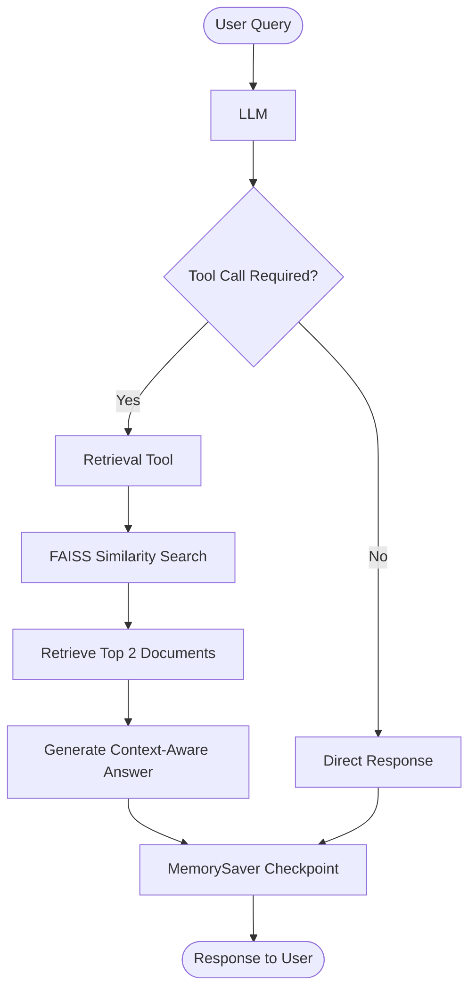

# 🧠 RAG with Persistent Memory using LangGraph

An AI-powered Retrieval-Augmented Generation (RAG) system that combines document retrieval with conversational memory using LangGraph.

This project demonstrates how an AI assistant can retrieve relevant information from a vector store while maintaining conversation history across multiple interactions within the same thread.

The implementation explores both a custom LangGraph workflow and a ReAct agent architecture with memory checkpointing.

## 🎯 Learning Objectives

- Understand conversational RAG architecture.
- Implement memory using LangGraph's `MemorySaver`.
- Maintain conversation history using `MessagesState`.
- Understand thread-based conversation management.
- Build a retrieval tool using FAISS.
- Implement a tool-calling workflow using LangGraph.
- Explore ReAct agents with persistent checkpoints.
- Generate context-aware responses using conversation history.

## 📚 Core Concepts

### 1. Document Ingestion

The system loads a blog article using `WebBaseLoader`.

Source document:

[Lilian Weng — LLM Powered Autonomous Agents](https://lilianweng.github.io/posts/2023-06-23-agent/)

The document is processed and prepared for embedding generation.

### 2. Text Chunking

Documents are split into smaller chunks using `RecursiveCharacterTextSplitter`.

| Parameter | Value |
|---|---|
| Chunk Size | 1000 |
| Chunk Overlap | 200 |

Chunking enables efficient retrieval of relevant document segments.

### 3. Embeddings

HuggingFace embeddings are generated using:

`sentence-transformers/all-MiniLM-L6-v2`

These embeddings represent document chunks in a semantic vector space.

### 4. Vector Store

FAISS is used to store document embeddings and perform similarity-based retrieval.

The retriever fetches the top 2 relevant documents for a query.

### 5. LangGraph Memory

LangGraph's `MemorySaver` acts as a checkpointer for conversation state.

The system uses:

- `MessagesState` to maintain conversation messages.
- `MemorySaver` to save graph checkpoints.
- `thread_id` to identify a conversation.
- `graph.get_state()` to retrieve conversation history.

**Important:** The notebook uses `MemorySaver`, which stores checkpoints in memory during runtime. It supports continuity across interactions within the same running application, but does not provide durable disk-based persistence across process restarts.

### 6. Tool Calling

The LLM decides whether to invoke the retrieval tool.

The retrieval tool performs FAISS similarity search and returns relevant context to the LLM.

### 7. ReAct Agent Architecture

The notebook also demonstrates a ReAct agent using:

`create_react_agent(llm, [retrieve], checkpointer=memory)`

This combines reasoning, tool execution, and thread-based memory checkpointing.

## 🔄 Architecture



## 🏗️ LangGraph Workflow

The custom workflow consists of the following nodes:

| Node | Responsibility |
|---|---|
| `query_or_respond` | LLM decides whether to retrieve information |
| `tools` | Executes the retrieval tool |
| `generate` | Generates an answer using retrieved context |

### Workflow Execution

1. User submits a query.
2. LLM decides whether a retrieval tool call is required.
3. LangGraph routes the execution using `tools_condition`.
4. The retrieval tool searches FAISS.
5. Retrieved context is passed to the generation node.
6. The LLM generates a concise answer.
7. LangGraph saves the conversation checkpoint.

## 🧪 Example Interaction

**User:**
What is Task Decomposition?

**Assistant:**
Provides an answer using retrieved information from the indexed document.

**User:**
Can you look up some common ways of doing it?

**Assistant:**
Uses the previous conversational context to understand what "it" refers to and retrieves relevant information.

This demonstrates conversational context retention.

## 🛠️ Tech Stack

| Technology | Purpose |
|---|---|
| Python | Core implementation |
| LangChain | LLM and retrieval integration |
| LangGraph | Graph-based orchestration |
| Groq | LLM inference |
| HuggingFace | Embeddings |
| FAISS | Vector similarity search |
| WebBaseLoader | Web document ingestion |
| MemorySaver | In-memory checkpointing |

## 📂 Project Structure

```text
6-RAG with Persistent Memory/
│
├── ragmemory.ipynb
└── README.md
```

## 📖 Learning Resources

| Concept | Resource |
|---|---|
| LangGraph | [Official Documentation](https://docs.langchain.com/oss/python/langgraph/overview) |
| LangGraph Persistence | [Persistence Documentation](https://docs.langchain.com/oss/python/langgraph/persistence) |
| Memory in LangGraph | [Memory Concepts](https://docs.langchain.com/oss/python/langgraph/add-memory) |
| ReAct Agents | [LangChain Agents](https://docs.langchain.com/oss/python/langchain/agents) |
| FAISS | [FAISS Documentation](https://faiss.ai/) |
| HuggingFace Embeddings | [Sentence Transformers](https://www.sbert.net/) |
| LangChain Retrieval | [Retrieval Documentation](https://docs.langchain.com/oss/python/langchain/retrieval) |

## 💡 Key Takeaways

- RAG combines knowledge retrieval with LLM generation.
- LangGraph enables stateful conversational workflows.
- `MemorySaver` provides in-memory checkpointing.
- `thread_id` enables separate conversation threads.
- ReAct agents can combine tool calling and memory.
- Conversation history allows the assistant to understand follow-up queries.

## 🚀 Future Improvements

- Implement durable memory using SQLite or PostgreSQL checkpointers.
- Add conversation summarization for long-running threads.
- Support multiple document sources.
- Add metadata filtering.
- Implement memory management for multi-user applications.
- Build a Streamlit chatbot interface.

## 👨‍💻 Author

**Aditya Kumar Singh**

GitHub: [@connectwithaadi](https://github.com/connectwithaadi)

---

⭐ This project is part of my Generative AI and Agentic AI learning journey.
