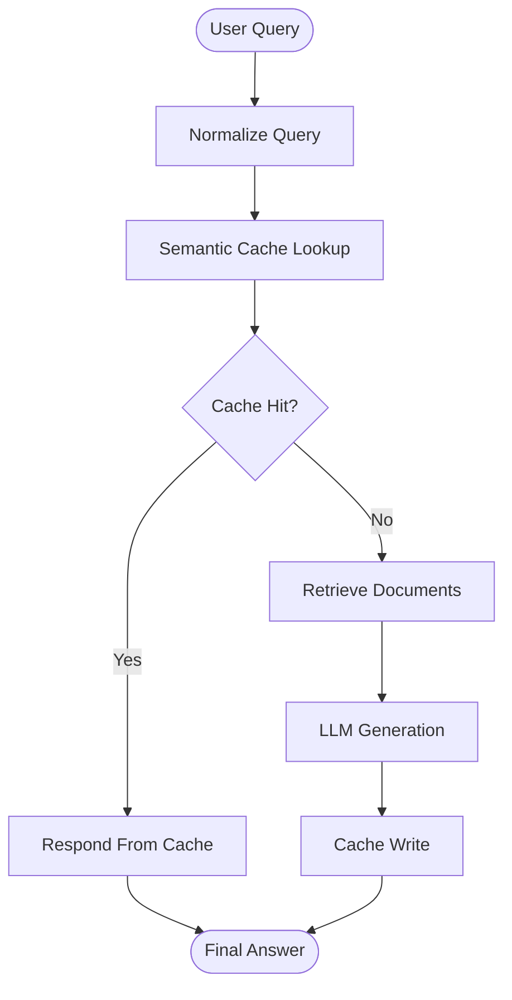

# ⚡ Cache-Augmented Generation (CAG)

## 📚 Overview

Cache-Augmented Generation (CAG) is an approach that improves LLM response efficiency by reusing previously generated responses or cached knowledge instead of performing the same computation repeatedly.

This project explores two caching approaches:

1. **Basic CAG:** Exact query-response caching using a Python dictionary.
2. **Advanced CAG:** Semantic caching integrated with a Retrieval-Augmented Generation (RAG) pipeline using LangGraph and FAISS.

The implementation demonstrates how caching can reduce redundant LLM calls, improve response latency, and optimize inference efficiency.

---

## 🧠 Concepts Covered

### 1. Basic CAG — Exact Query Caching

The basic implementation uses a Python dictionary (`Model_Cache`) to store query-response pairs.

**Workflow:**

- Receive a user query.
- Check whether the query exists in the cache.
- If a cache hit occurs, return the stored response.
- If a cache miss occurs, invoke the LLM.
- Store the generated response for future requests.

**Key Features:**
- Exact query matching
- Cache Hit and Cache Miss detection
- Response reuse
- Execution time measurement
- Reduced redundant LLM invocations

### 2. Advanced CAG — Semantic Caching with RAG

The advanced implementation combines semantic caching with a LangGraph-based RAG workflow.

Instead of relying only on exact string matching, the system uses embeddings to identify semantically similar queries.

**Technologies:**
- LangGraph — Workflow orchestration
- FAISS — Vector-based semantic cache
- HuggingFace Embeddings — Query embeddings
- LangChain — LLM integration
- Groq — LLM inference
- MemorySaver — Workflow checkpointing

### ⚙️ Advanced CAG Workflow

1. **Normalize Query:** Convert the user query into a normalized format.
2. **Semantic Cache Lookup:** Search the FAISS cache for semantically similar queries.
3. **Cache Hit:** Return the previously cached answer.
4. **Cache Miss:** Retrieve relevant documents from the knowledge store.
5. **Generate:** Use the LLM to generate a context-aware response.
6. **Cache Write:** Store the generated answer in the semantic cache.
7. **End:** Return the final response.

---

## 🏗️ Architecture



---

## 🛠️ Configuration

| Parameter | Value |
|---|---|
| Embedding Model | sentence-transformers/all-MiniLM-L6-v2 |
| Vector Dimension | 384 |
| LLM | openai/gpt-oss-120b |
| Temperature | 0 |
| Retrieval Top-K | 4 |
| Cache Top-K | 3 |
| Cache Distance Threshold | 0.45 |
| Cache TTL | Disabled (0 seconds) |
| Vector Database | FAISS |

---

## 🚀 Key Features

- Exact query-response caching
- Semantic similarity-based caching
- Cache Hit and Cache Miss handling
- FAISS vector store integration
- LangGraph state-based workflow
- Retrieval-based answer generation
- LLM response reuse
- Configurable cache threshold and retrieval parameters
- Reduced redundant LLM calls

---

## 📂 Project Structure

```text
7-Cache RAG/
│
├── README.md
│
└── cache_rag.ipynb
```

---

## 📓 Notebook

[Explore Cache RAG Implementation](./cache_rag.ipynb)

The notebook includes the basic caching implementation, advanced semantic caching, LangGraph workflow, FAISS integration, and demonstration queries.

---

## 🎯 Learning Outcomes

- Understanding Cache-Augmented Generation
- Implementing exact query-response caching
- Understanding semantic caching with embeddings
- Integrating FAISS with LangChain
- Building stateful workflows using LangGraph
- Understanding cache hit and cache miss scenarios
- Improving LLM inference efficiency through caching

---

## 👨‍💻 Author

**Aditya Kumar Singh**

GitHub: [@connectwithaadi](https://github.com/connectwithaadi)

---

⭐ This project is part of my Generative AI and Agentic AI learning journey.
