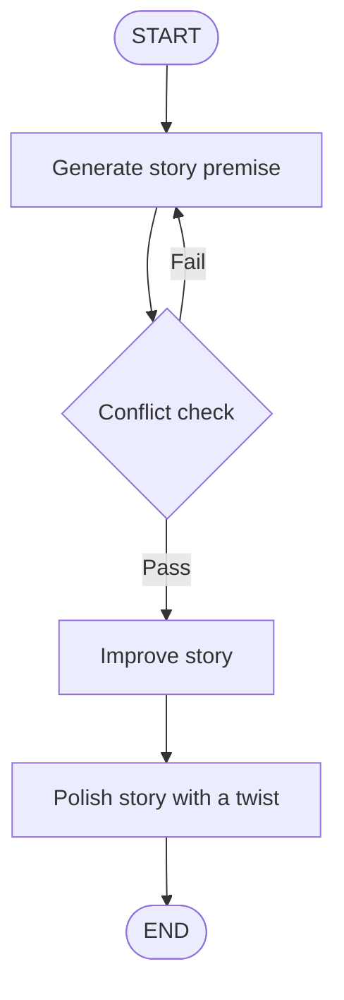
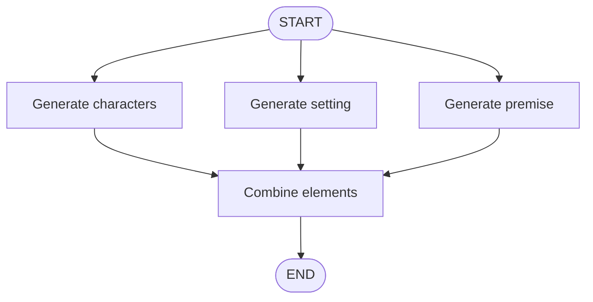
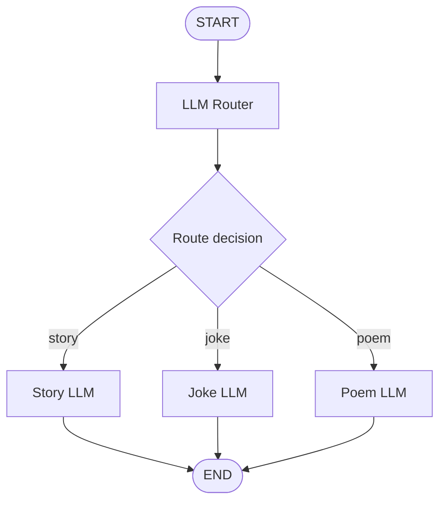
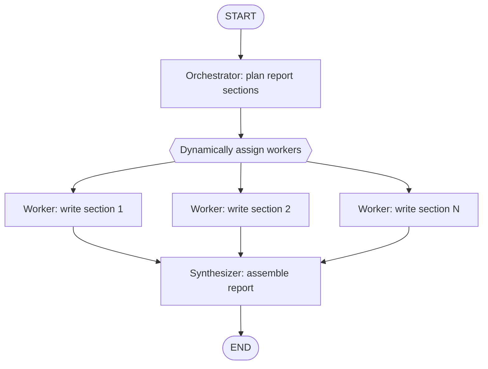
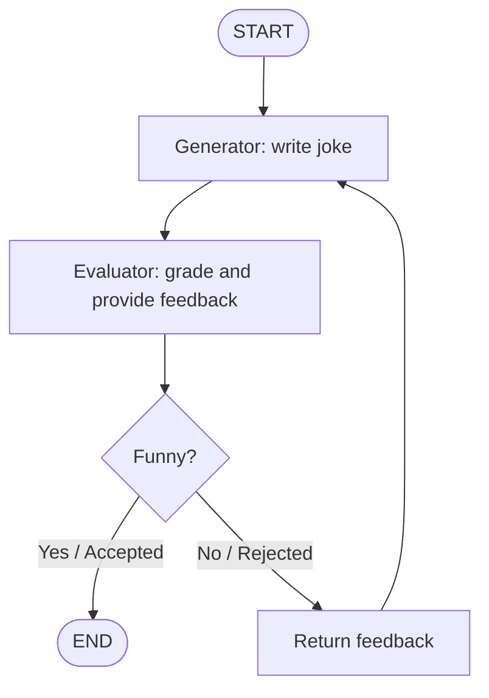

# 🔀 Different Workflows in LangGraph

A hands-on collection of five LangGraph workflow patterns, implemented in Jupyter notebooks with **Groq (`ChatGroq`)**. This project explores how to structure LLM applications with sequential steps, parallel branches, conditional routing, dynamic task delegation, and evaluation-feedback loops.

> The workflow summaries and Mermaid diagrams below follow the notebooks in this folder and the accompanying workflow notes.

## 📚 Concepts & Notebooks

### 1. Prompt Chaining
**Notebook:** [📓 `1-Prompt_Chaining.ipynb`](./1-Prompt_Chaining.ipynb)

Prompt chaining divides a larger task into smaller sequential prompts. In this notebook, the model generates a story premise, checks it, improves it, and polishes it with an unexpected twist. A conditional edge sends a premise back to generation if it fails the check.



**Key idea:** each stage builds on the output of the previous stage. This is useful when the task benefits from a controlled sequence of transformations.

---

### 2. Parallelization
**Notebook:** [📓 `2-Parallelization.ipynb`](./2-Parallelization.ipynb)

Independent story elements are generated concurrently: characters, setting, and premise. A combine node waits for these outputs and creates the story introduction.



**Key idea:** execute independent work in parallel, then aggregate the results. This can reduce latency when branches do not depend on one another.

---

### 3. Routing
**Notebook:** [📓 `3-Routing.ipynb`](./3-Routing.ipynb)

A structured-output router classifies the user request into a route—`story`, `joke`, or `poem`—and sends it to the corresponding LLM node.



**Key idea:** use conditional edges to select the next node based on the request or workflow state instead of following a fixed path.

---

### 4. Orchestrator–Worker
**Notebook:** [📓 `4-Orchestrator-worker.ipynb`](./4-Orchestrator-worker.ipynb)

An orchestrator plans the sections of a report from the input topic. LangGraph's `Send` API dispatches the planned sections to worker calls; a synthesizer combines the completed sections into a final report.



**Key idea:** unlike fixed parallelization, the orchestrator determines the subtasks dynamically from the request. Workers can run on separate section tasks, and their outputs are synthesized.

---

### 5. Evaluator–Optimizer
**Notebook:** [📓 `5-Evaluator-optimizer.ipynb`](./5-Evaluator-optimizer.ipynb)

The generator writes a joke, and the evaluator grades it as `funny` or `not funny` with feedback. If accepted, the graph ends; otherwise, feedback is passed back to the generator for another attempt.



**Key idea:** iterative refinement is useful when there are clear evaluation criteria and feedback can improve the generated result.

---

## 🧭 Workflow Patterns at a Glance

| Pattern | Flow style | Best suited for |
|---|---|---|
| Prompt Chaining | Sequential with conditional retry | Multi-stage tasks where each step depends on the previous output |
| Parallelization | Independent branches + aggregation | Tasks that can be split into independent components |
| Routing | Conditional branching | Choosing a specialized path based on input or state |
| Orchestrator–Worker | Dynamic planning and delegation | Complex tasks with unpredictable subtasks |
| Evaluator–Optimizer | Generate–evaluate loop | Outputs that can be assessed and improved using explicit feedback |

## 🛠️ Tech Stack

- **Python**
- **LangGraph** — graph-based workflow orchestration
- **LangChain** — LLM integration
- **Groq (`ChatGroq`)** — model provider integration
- **Pydantic** — structured output schemas and validation
- **python-dotenv** — environment variable loading
- **Jupyter Notebook / VS Code**

## ⚙️ Setup & Run

### 1. Clone the repository

```bash
git clone https://github.com/connectwithaadi/GenerativeAI-Learn.git
cd GenerativeAI-Learn
```

Open the `Agentic AI/10-Different Workflows in langgraph` folder in Jupyter Notebook or VS Code.

### 2. Install dependencies

```bash
pip install langgraph langchain-core langchain-groq python-dotenv pydantic typing-extensions ipython
```

### 3. Configure the Groq API key

Create a `.env` file in the notebook's working directory:

```env
GROQ_API_KEY=your_groq_api_key
```

Get a key from [Groq Console](https://console.groq.com/).

> 🔐 Keep your API key private. Do not upload `.env` to GitHub.

### 4. Run the notebooks

Run each notebook from top to bottom:

1. [Prompt Chaining](./1-Prompt_Chaining.ipynb)
2. [Parallelization](./2-Parallelization.ipynb)
3. [Routing](./3-Routing.ipynb)
4. [Orchestrator–Worker](./4-Orchestrator-worker.ipynb)
5. [Evaluator–Optimizer](./5-Evaluator-optimizer.ipynb)

The notebooks use `ChatGroq` with the model ID `openai/gpt-oss-120b`. Check the provider's current model availability and API configuration if you encounter a model-access error.

## 🎯 Learning Objectives

- Build workflows using LangGraph `StateGraph`, nodes, edges, and shared state.
- Design sequential and conditional execution.
- Run independent LLM tasks in parallel and combine their results.
- Use structured output to make routing decisions.
- Dynamically delegate tasks with the LangGraph `Send` API.
- Implement evaluation-feedback cycles for iterative output improvement.
- Understand the trade-offs between fixed and dynamic workflow patterns.

## 📖 References

- [LangGraph Documentation](https://docs.langchain.com/oss/python/langgraph/overview)
- [LangGraph Workflows and Agents](https://docs.langchain.com/oss/python/langgraph/workflows-agents)
- [LangGraph `Send` API](https://docs.langchain.com/oss/python/langgraph/graph-api)
- [LangChain Documentation](https://python.langchain.com/docs/introduction/)
- [Groq API Documentation](https://console.groq.com/docs/)
- [Pydantic Documentation](https://docs.pydantic.dev/)

---

## 👨‍💻 Author

**Aditya Kumar Singh**

GitHub: [@connectwithaadi](https://github.com/connectwithaadi)

---

⭐ This project is part of my Generative AI and Agentic AI learning journey.

