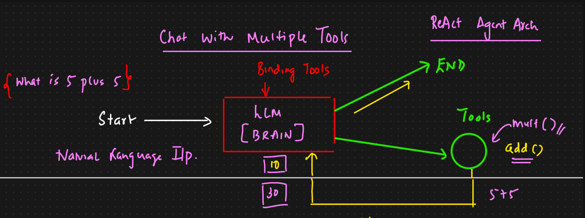
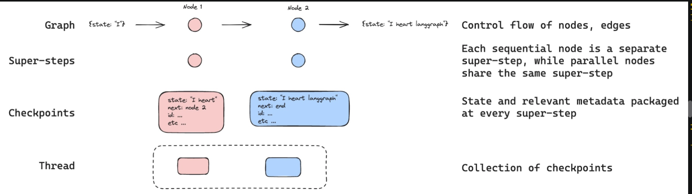

# 🤖 ReAct Agent — Multi-Tool AI Agent with LangGraph

A hands-on Agentic AI project demonstrating the **ReAct (Reasoning + Acting) architecture** using LangChain and LangGraph.

This project builds an AI agent that can understand natural-language instructions, decide which tools to use, execute tool calls, observe their results, and continue reasoning until it generates a final response.

The agent integrates multiple tools, including Wikipedia, Arxiv, Tavily Search, and custom mathematical functions. It also explores agent memory using LangGraph's `MemorySaver` checkpointer, enabling contextual follow-up conversations within a thread.

---

## 🎯 Learning Objectives

- Understand the ReAct (Reasoning and Acting) agent architecture.
- Learn how LLMs interact with external tools.
- Implement custom tools using LangChain.
- Integrate Wikipedia and Arxiv search tools.
- Perform web searches using Tavily.
- Bind multiple tools to an LLM using `bind_tools()`.
- Build an agent workflow using LangGraph.
- Understand state management using `TypedDict`.
- Implement conditional routing with `tools_condition`.
- Execute tool calls using LangGraph's `ToolNode`.
- Introduce conversational memory using `MemorySaver`.
- Understand thread-based state persistence and contextual follow-up queries.

---

## 📂 Project Structure

```text
1-ReActAgent/
│
├── ReActAgent.ipynb
├── image.png
├── image2.png
└── README.md
```

### File Description

| File | Description |
|---|---|
| `ReActAgent.ipynb` | Notebook containing the complete implementation and experiments. |
| `image.png` | ReAct agent architecture illustration. |
| `image2.png` | Agent memory and LangGraph workflow illustration. |
| `README.md` | Project documentation and learning notes. |

---

## 🧠 Core Concepts

### 1. What Is ReAct Architecture?

ReAct stands for **Reasoning + Acting**.

It is an agent architecture in which an LLM reasons about a user's request, decides whether an external tool is required, executes the tool, observes its output, and uses that observation to decide the next action.

The three fundamental stages are:

1. **Reason:** The LLM determines what needs to be done.
2. **Act:** The agent selects and executes an appropriate tool.
3. **Observe:** The tool output is returned to the LLM for further reasoning.

This cycle continues until the agent can provide a final answer.

### ReAct Architecture



### 2. Tool Calling

Tool calling allows an LLM to interact with external functions and services.

Instead of answering every question directly, the model can select an appropriate tool based on the user's request.

This project implements the following tools:

| Tool | Purpose |
|---|---|
| Arxiv | Search research papers and retrieve paper information. |
| Wikipedia | Retrieve information about concepts and topics. |
| Tavily Search | Search the web for relevant and recent information. |
| `add()` | Perform addition. |
| `multiply()` | Perform multiplication. |
| `divide()` | Perform division. |

Tools are registered and bound to the LLM:

```python
tools = [arxiv, wiki, tavily, add, divide, multiply]

llm_with_tools = llm.bind_tools(tools)
```

The LLM can then decide which tool to invoke based on the user's request.

### 3. LangGraph State Management

LangGraph provides a graph-based approach to building agent workflows.

The notebook defines a state schema using `TypedDict` and LangChain's message reducer.

```python
class State(TypedDict):
    messages: Annotated[list[AnyMessage], add_messages]
```

The state maintains the conversation messages as the agent moves between nodes.

### 4. Conditional Routing

The agent uses LangGraph's `tools_condition` to determine what happens after the LLM responds.

- If the LLM generates a tool call, execution is routed to the `tools` node.
- If no tool call is generated, the graph reaches its end.

This creates a dynamic tool-execution loop rather than a fixed sequence of operations.

### 5. Agent Memory with MemorySaver

The project also introduces conversational memory using LangGraph's `MemorySaver`.

It allows the agent to preserve graph state between interactions belonging to the same conversation thread.

```python
from langgraph.checkpoint.memory import MemorySaver

memory = MemorySaver()

graph_memory = builder.compile(
    checkpointer=memory
)
```

A thread ID identifies the conversation:

```python
config = {
    "configurable": {
        "thread_id": "1"
    }
}
```

The agent can use previous messages to understand follow-up instructions.

For example:

- User: Add 12 and 13.
- Agent: 25.
- User: Add that number to 25.
- Agent: 50.
- User: Then multiply that number by 2.
- Agent: 100.

The notebook demonstrates this contextual interaction using the same thread ID.

**Note:** `MemorySaver` stores checkpoints in memory. This implementation does not provide permanent storage across application restarts.

---

## ⚙️ Implementation Workflow

### Step 1: Initialize External Tools

The notebook imports and configures the Arxiv and Wikipedia integrations using LangChain Community.

It also creates a custom Arxiv search function using the Arxiv API.

### Step 2: Create Custom Mathematical Functions

Three Python functions are defined:

- `add(a, b)`
- `multiply(a, b)`
- `divide(a, b)`

These functions are registered as tools that the LLM can invoke.

### Step 3: Integrate Tavily Search

The Tavily Search tool is initialized to provide web search capabilities.

```python
from langchain_community.tools.tavily_search import TavilySearchResults

tavily = TavilySearchResults()
```

### Step 4: Initialize the LLM

The project uses Groq through LangChain's `ChatGroq` integration.

```python
from langchain_groq import ChatGroq

llm = ChatGroq(
    model="openai/gpt-oss-120b",
    temperature=0
)

llm_with_tools = llm.bind_tools(tools)
```

### Step 5: Build the LangGraph Workflow

The graph contains two primary nodes:

- `tool_calling_llm`: Invokes the LLM with the current conversation state.
- `tools`: Executes the tools selected by the LLM.

The graph uses conditional routing to decide whether another tool execution is required.

```python
builder = StateGraph(State)

builder.add_node(
    "tool_calling_llm",
    tool_calling_llm
)

builder.add_node(
    "tools",
    ToolNode(tools)
)

builder.add_edge(
    START,
    "tool_calling_llm"
)

builder.add_conditional_edges(
    "tool_calling_llm",
    tools_condition
)

builder.add_edge(
    "tools",
    "tool_calling_llm"
)

graph = builder.compile()
```

### Step 6: Execute the Agent

The agent can process requests involving multiple tools.

Example:

```python
messages = graph.invoke({
    "messages": HumanMessage(
        content="Provide me the top 10 recent AI news for March 3rd 2025, add 5 plus 5 and then multiply by 10"
    )
})
```

This request demonstrates how the agent can combine external information retrieval with mathematical tool execution.

### Step 7: Add Agent Memory

The graph is compiled again with a `MemorySaver` checkpointer.

The same thread ID is passed across multiple invocations, allowing the agent to maintain conversational context.

---

## 🔄 Overall Architecture

```text
             User Input
                  |
                  v
           ReAct AI Agent
                  |
                  v
             Groq LLM
          (GPT-OSS 120B)
                  |
                  v
             Tool Binding
                  |
                  v
           Tool Selection
                  |
                  v
          Conditional Router
                  |
          +-------+--------+
          |                |
       Tool Call        No Tool Call
          |                |
          v                v
      ToolNode            END
          |
    +-----+-------------------+
    |          |              |
    v          v              v
 Wikipedia   Arxiv          Tavily
    |          |              |
    +----------+--------------+
                  |
                  v
           Tool Observation
                  |
                  v
              Groq LLM
                  |
           +------+------+
           |             |
        More Tools    Final Answer
           |
           v
       ToolNode
           |
           +---- Repeat

       MemorySaver
           |
       Thread State
```

---

## 🧠 Agent Memory Architecture

The project introduces checkpoint-based memory using LangGraph.



The notebook demonstrates:

- Graph state persistence between invocations.
- Checkpoint creation after graph execution steps.
- Thread-based conversation management.
- Contextual understanding of follow-up questions.
- Reusing previous tool results through conversation history.

---

## 🛠️ Technology Stack

| Technology | Purpose |
|---|---|
| Python | Core implementation |
| Jupyter Notebook | Interactive experimentation |
| LangChain | LLM and tool integration |
| LangGraph | Agent workflow orchestration |
| Groq | LLM inference |
| GPT-OSS 120B | Configured language model |
| Wikipedia | Knowledge retrieval |
| Arxiv API | Research paper retrieval |
| Tavily | Web search |
| MemorySaver | In-memory graph checkpointing |
| LangSmith | Agent tracing and observability |
| python-dotenv | Environment variable management |

---

## 🚀 Getting Started

### Prerequisites

- Python installed.
- Jupyter Notebook or JupyterLab.
- Groq API key.
- Tavily API key.
- LangSmith API key (optional, for tracing).

### 1. Clone the Repository

```bash
git clone https://github.com/connectwithaadi/GenerativeAI-Learn.git
```

### 2. Navigate to the Project

```bash
cd GenerativeAI-Learn
cd "Agentic AI/2-Agents Architecture/1-ReActAgent"
```

### 3. Install Dependencies

Using `uv`:

```bash
uv add langchain langchain-community langchain-core
uv add langgraph langchain-groq
uv add wikipedia requests python-dotenv
uv add arxiv
```

Install any additional packages required by your local notebook environment.

### 4. Configure Environment Variables

Create a `.env` file in the project directory:

```env
GROQ_API_KEY=your_groq_api_key
TAVILY_API_KEY=your_tavily_api_key

LANGCHAIN_API_KEY=your_langsmith_api_key
LANGCHAIN_TRACING_V2=true
LANGCHAIN_PROJECT=ReAct-agent
```

Keep your API keys private and never commit `.env` to GitHub.

### 5. Run the Notebook

Open:

```text
ReActAgent.ipynb
```

Execute the notebook cells sequentially to explore tool integration, agent execution, LangGraph orchestration, and memory.

---

## 📌 Key Takeaways

- ReAct combines reasoning, action, and observation.
- LLMs can dynamically select tools based on user instructions.
- Tool calling connects language models with external functions and services.
- LangGraph provides structured control flow for agentic applications.
- Conditional routing enables dynamic tool execution.
- `ToolNode` executes the selected tools.
- `MemorySaver` enables thread-based conversational state persistence.
- An agent can combine multiple tools to solve a single complex request.

---

## 🔮 Future Improvements

- Add persistent checkpoint storage using a database.
- Implement human-in-the-loop tool approval.
- Add tool execution error handling and retries.
- Introduce multiple specialized agents.
- Add streaming responses.
- Add tool execution logging and monitoring.
- Implement FastAPI endpoints for agent interaction.
- Add authentication and access control.
- Explore MCP integration for standardized external tool connectivity.
- Deploy the agent as a production-ready application.

---

## 👨‍💻 Author

**Aditya Kumar Singh (Aadi)**

GitHub: [@connectwithaadi](https://github.com/connectwithaadi)

Repository: [GenerativeAI-Learn](https://github.com/connectwithaadi/GenerativeAI-Learn)

*Part of my hands-on learning journey toward Agentic AI and AI Engineering.*
