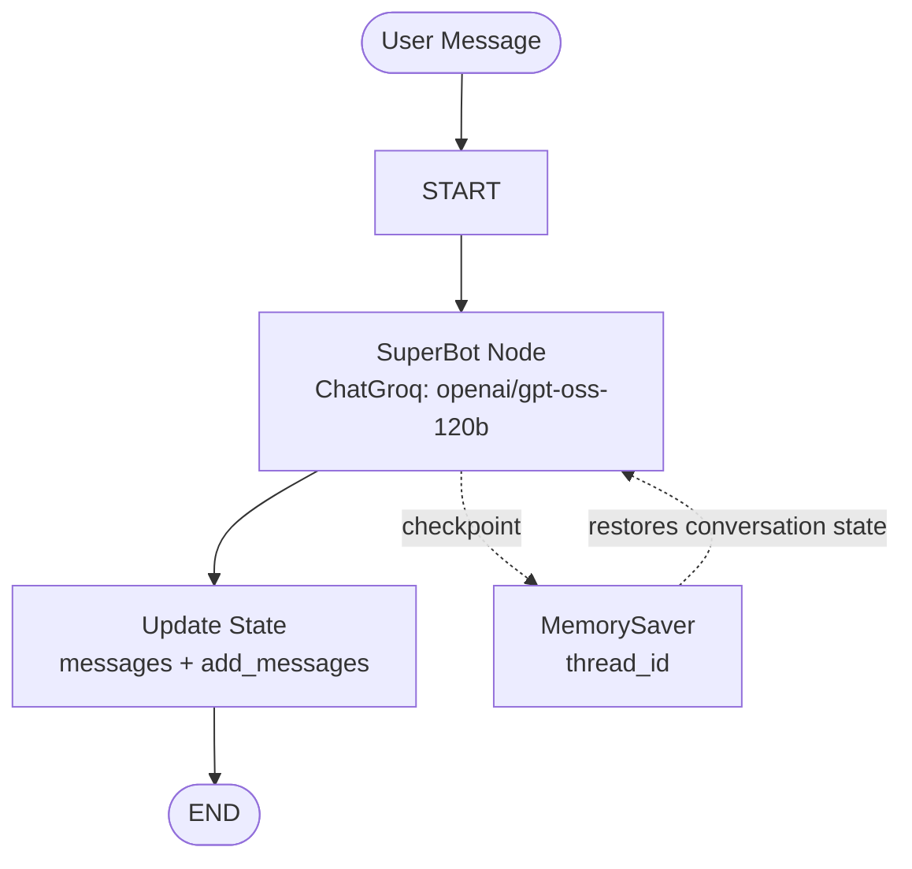
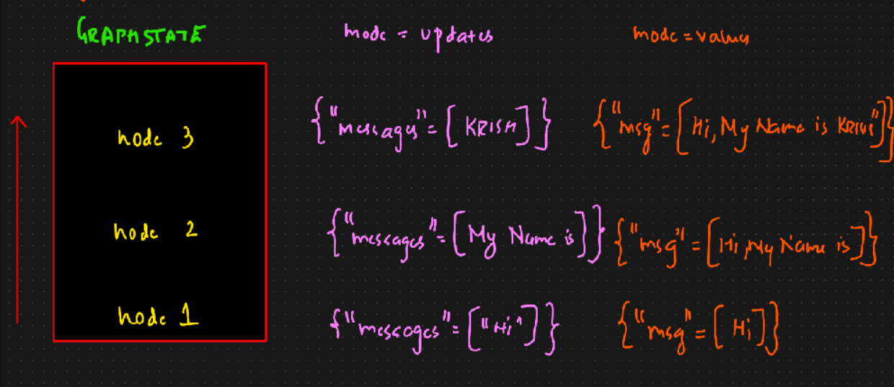

# LangGraph Streaming — Stateful Chatbot

A hands-on notebook demonstrating how to build a simple conversational chatbot with **LangGraph** and **Groq**, preserve conversation context using a thread checkpoint, and stream graph outputs and model events.

Notebook: [`Streaming.ipynb`](./Streaming.ipynb)

## Overview

The notebook creates a single-node LangGraph chatbot:

- **State:** A `TypedDict` state containing `messages`, annotated with LangGraph's `add_messages` reducer.
- **LLM:** `ChatGroq` using the `openai/gpt-oss-120b` model with `temperature=0`.
- **Node:** `SuperBot` invokes the LLM with the current message history.
- **Graph:** `START → SuperBot → END`.
- **Checkpointing:** `MemorySaver` stores graph state by `thread_id`, enabling the chatbot to continue a conversation in the same thread.

## Architecture



## Streaming Concepts

The notebook demonstrates two ways to stream graph execution.

### 1. `graph.stream()`

Synchronous streaming of graph state:

| `stream_mode` | What it emits |
|---|---|
| `updates` | State updates produced by each node |
| `values` | The complete graph state after each node executes |

The notebook invokes these modes over a conversation using `thread_id="3"` to illustrate message history continuing across turns.

### 2. `graph.astream_events()`

Asynchronous event streaming, useful for observing events inside graph nodes and streaming model output as it is generated.

The notebook uses `version="v2"`. Events include fields such as:

- `event` — event type
- `name` — event or runnable name
- `data` — associated event data
- `metadata` — execution metadata, including the LangGraph node

### Streaming State Illustration

The accompanying `stream.png` illustrates how sequential node execution produces checkpoints/state updates, and how update-style output differs from full-value state output.



## Tech Stack

- Python
- LangGraph — graph orchestration and state management
- LangChain Groq integration — chat model
- Groq — LLM inference
- `TypedDict` and `Annotated` — state schema and reducer annotation
- `MemorySaver` — in-memory checkpointing
- Jupyter Notebook — interactive development

## Setup

### 1. Clone the repository

```bash
git clone https://github.com/connectwithaadi/GenerativeAI-Learn.git
cd GenerativeAI-Learn
```

### 2. Navigate to this folder

```bash
cd "Agentic AI/2-Agents Architecture/2-Streaming"
```

### 3. Create a virtual environment

Windows PowerShell:

```powershell
python -m venv .venv
.venv\Scripts\Activate.ps1
```

macOS / Linux:

```bash
python -m venv .venv
source .venv/bin/activate
```

### 4. Install dependencies

```bash
pip install langgraph langchain-groq langchain-core typing-extensions python-dotenv jupyter
```

### 5. Configure API keys

Create a `.env` file in the notebook folder:

```env
GROQ_API_KEY=your_groq_api_key
OPENAI_API_KEY=your_openai_api_key
```

The notebook loads these variables using `python-dotenv`. The chatbot model call shown uses Groq. Keep `.env` private and never commit API keys.

### 6. Run the notebook

```bash
jupyter notebook Streaming.ipynb
```

Run cells sequentially.

## Example

The notebook starts a thread and sends messages such as:

```python
config = {"configurable": {"thread_id": "3"}}

graph_builder.stream(
    {"messages": "Hi, my name is Aadi and I like cricket"},
    config,
    stream_mode="updates"
)
```

Follow-up messages in the same thread demonstrate checkpoint-backed conversation continuity.

## Learning Objectives

- Define graph state with `TypedDict`.
- Use `add_messages` to merge message updates.
- Create and compile a `StateGraph`.
- Add nodes and connect `START` and `END`.
- Use `MemorySaver` and `thread_id` for conversational checkpoints.
- Understand `stream_mode="updates"` versus `stream_mode="values"`.
- Explore asynchronous graph/model events with `astream_events()`.

## Author

**Aditya Kumar Singh (Aadi)**

[GitHub — connectwithaadi](https://github.com/connectwithaadi)

---

Part of the [GenerativeAI-Learn](https://github.com/connectwithaadi/GenerativeAI-Learn) repository.

