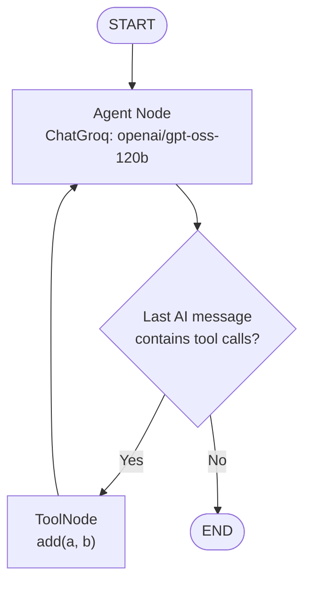

# LangGraph Agent — Debugging & Graph Configuration

A compact LangGraph example that exposes a Groq-powered agent graph for local development and debugging. The project defines two graph variants: a basic LLM graph and a tool-calling graph that can invoke an addition tool and return to the agent.

## 📁 Project Files

| File | Description |
|---|---|
| [`groq_agent.py`](./groq_agent.py) | Defines the graph state, Groq chat model, default graph, and tool-calling graph |
| [`langgraph.json`](./langgraph.json) | LangGraph application configuration that registers the `groq_agent` graph and environment file |
| `README.md` | Project documentation |

## 🧠 Architecture

The active graph is assigned as:

```python
agent = make_alternative_graph()
```

This graph uses a tool-calling loop:



### Graph State

The graph uses a `TypedDict` state with a message list:

```python
class State(TypedDict):
    messages: Annotated[list[BaseMessage], add_messages]
```

The `add_messages` reducer appends/merges message updates into the graph state, allowing the model's response and tool interactions to remain in the message history.

## 🔀 Graph Variants

### 1. Default Graph — `make_default_graph()`

A simple one-pass graph:

```text
START → agent → END
```

The `agent` node invokes the Groq chat model with the current messages and returns the model response.

### 2. Alternative Tool-Calling Graph — `make_alternative_graph()`

The active graph binds an `add` tool to the model.

- **Agent node:** Calls the model with tool binding enabled.
- **ToolNode:** Executes the selected `add(a, b)` tool.
- **Conditional routing:** Sends the graph to `tools` if the last message contains tool calls; otherwise routes to `END`.
- **Loop:** After tool execution, control returns to the agent so it can use the tool result and respond.

## ⚙️ LangGraph Application Configuration

The `langgraph.json` file registers the graph:

```json
{
  "dependencies": ["."],
  "graphs": {
    "groq_agent": "./groq_agent.py:agent"
  },
  "env": "../.env"
}
```

This points the LangGraph application to the `agent` object in `groq_agent.py` and specifies an environment file one directory above this folder.

## 🧰 Tech Stack

- Python
- LangGraph — state graph and conditional routing
- LangChain Groq — chat model integration
- Groq — LLM inference
- LangChain Core — tools and message types
- `TypedDict` / `Annotated` — graph state definition
- LangGraph `ToolNode` — tool execution
- LangGraph CLI — local graph development and debugging

## 🚀 Setup

### 1. Clone the repository

```bash
git clone https://github.com/connectwithaadi/GenerativeAI-Learn.git
cd GenerativeAI-Learn
```

### 2. Navigate to the Debugging folder

```bash
cd "Agentic AI/2-Agents Architecture/Debugging"
```

### 3. Create and activate a virtual environment

Windows PowerShell:

```powershell
python -m venv .venv
.venv\Scripts\Activate.ps1
```

macOS / Linux:

```bash
python -m venv .venv
source .venv/bin/activate
```

### 4. Install dependencies

```bash
pip install langgraph langgraph-cli[inmem] langchain-groq langchain-core python-dotenv
```

### 5. Configure environment variables

The graph config points to `../.env`. Add the required Groq API key there:

```env
GROQ_API_KEY=your_groq_api_key
```

The Python module also reads `LANGCHAIN_API_KEY` and assigns it to `LANGSMITH_API_KEY` for LangSmith tracing configuration. Set these only if using LangSmith:

```env
LANGCHAIN_API_KEY=your_langsmith_api_key
LANGCHAIN_TRACING_V2=true
LANGCHAIN_PROJECT=your_project_name
```

Keep secrets out of Git. Do not commit `.env` files or real API keys.

### 6. Start the local LangGraph development server

Run from the Debugging folder:

```bash
langgraph dev
```

Use the local development interface/API to inspect graph execution, node transitions, and tool calls. Ensure the CLI is installed and the configured environment file is available.

## 🧪 Example Tool

The graph defines an addition tool:

```python
@tool
def add(a: float, b: float):
    """Adds two numbers."""
    return a + b
```

A question such as `What is 12 + 30?` can lead the model to call the tool, receive its result, and continue to a final response. Tool selection is model-driven.

## 🎯 Learning Objectives

- Create a LangGraph workflow using `StateGraph`.
- Define message state using `TypedDict` and `add_messages`.
- Bind tools to a Groq chat model.
- Execute tools using `ToolNode`.
- Implement conditional edges based on model tool calls.
- Understand the agent → tool → agent cycle.
- Register a graph using `langgraph.json` for local debugging.

## 👨‍💻 Author

**Aditya Kumar Singh (Aadi)**

[GitHub — connectwithaadi](https://github.com/connectwithaadi)

---

Part of the [GenerativeAI-Learn](https://github.com/connectwithaadi/GenerativeAI-Learn) repository.

