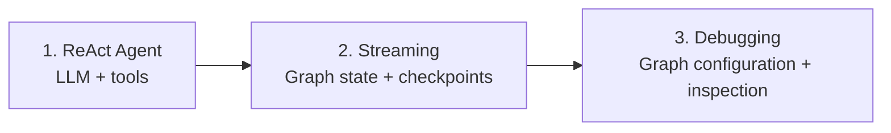
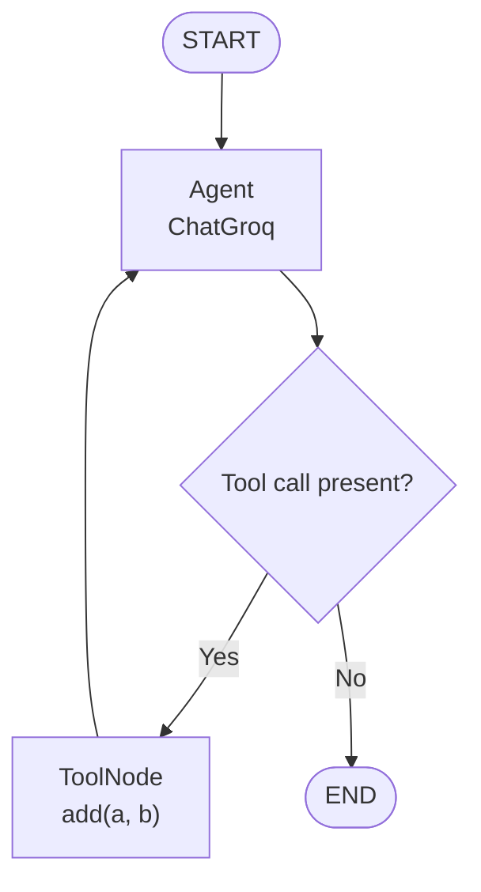

# Agents Architecture — LangGraph & Tool-Using Agents

This section of **GenerativeAI-Learn** explores agent architecture with LangGraph through three practical modules: a ReAct agent, streaming and checkpointed chatbot execution, and a Groq-powered graph configured for debugging.

## 📚 Modules

| Module | Folder | What it covers |
|---|---|---|
| 1 | [`1-ReActAgent`](./1-ReActAgent/) | ReAct-style agent that reasons about a user request and selects tools for execution |
| 2 | [`2-Streaming`](./2-Streaming/) | LangGraph chatbot state, checkpointing, `stream()` modes, and asynchronous event streaming |
| 3 | [`Debugging`](./Debugging/) | Basic and tool-calling Groq graphs, conditional routing, and LangGraph CLI configuration |

Open each module folder for its own README, notebook, code, and related diagrams.

## 🧭 Learning Roadmap



### 1. ReAct Agent — Reason and Act

Learn the tool-using agent pattern: the LLM receives a natural-language task, decides whether a tool is needed, receives the tool observation, and continues toward a response.

Topics represented in the module:
- Binding tools to a chat model
- Tool invocation and results
- Agent/tool interaction flow
- LangGraph orchestration

📂 [Explore 1-ReActAgent](./1-ReActAgent/)

### 2. Streaming — Stateful Chatbot Execution

Build a LangGraph chatbot using a message-based state and a Groq chat model.

Topics:
- `StateGraph`, `START`, and `END`
- `TypedDict` state with `add_messages`
- `MemorySaver` checkpointing with `thread_id`
- `graph.stream()` using `updates` and `values`
- `graph.astream_events()` for execution/model events

The `stream.png` diagram in the module illustrates state updates versus full state values across sequential node execution.

📂 [Explore 2-Streaming](./2-Streaming/)

### 3. Debugging — Groq Agent Graph

Configure and inspect a Groq-powered LangGraph agent. The Python module provides a default one-pass graph and an alternative tool-calling graph; the active `agent` uses the alternative graph.

**Tool-calling flow:**



Topics:
- Graph state and message reducers
- `model.bind_tools(...)`
- `ToolNode` for tool execution
- Conditional routing based on tool calls
- `langgraph.json` graph registration
- Local development with `langgraph dev`

📂 [Explore Debugging](./Debugging/)

## 🧰 Technologies

- **Python** — implementation
- **LangGraph** — graph construction, state, edges, conditional routing, and execution
- **LangChain / LangChain Core** — model integrations, tools, and message abstractions
- **Groq** — chat model inference
- **LangGraph checkpointing** — thread-based state persistence in the streaming module
- **LangGraph CLI** — local graph development and debugging
- **Jupyter Notebook** — interactive learning

## ⚙️ Getting Started

### Clone the repository

```bash
git clone https://github.com/connectwithaadi/GenerativeAI-Learn.git
cd GenerativeAI-Learn
```

### Navigate to this section

```bash
cd "Agentic AI/2-Agents Architecture"
```

Choose a module folder and follow its README for environment setup, package installation, API-key configuration, and execution steps.

### Environment variables

Depending on the selected module, configure the Groq API key in a local `.env` file:

```env
GROQ_API_KEY=your_groq_api_key
```

Some graph-debugging setups may also use LangSmith tracing credentials. Set them only if you plan to enable tracing. Never commit `.env` files or expose API keys in notebooks, screenshots, or Git history.

## 🎯 Learning Objectives

By completing these modules, you can:
- Understand the ReAct (Reason + Act) agent loop.
- Connect LLMs to callable tools.
- Represent agent workflows as LangGraph nodes and edges.
- Manage messages and graph state with reducers.
- Stream graph updates and model events.
- Preserve conversation state using checkpoints and thread IDs.
- Route execution conditionally based on tool calls.
- Configure and inspect graphs with the LangGraph development tooling.

## 👨‍💻 Author

**Aditya Kumar Singh (Aadi)**

[GitHub — connectwithaadi](https://github.com/connectwithaadi)

---

Part of the [GenerativeAI-Learn](https://github.com/connectwithaadi/GenerativeAI-Learn) repository.
