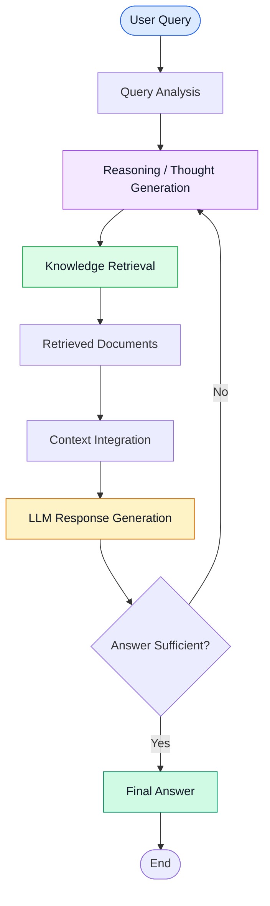

# 🧠 CoT-RAG — Chain-of-Thought Retrieval-Augmented Generation

An exploration of **Chain-of-Thought Retrieval-Augmented Generation (CoT-RAG)**, an advanced RAG approach that combines reasoning with external knowledge retrieval to improve the quality and relevance of AI-generated responses.

This notebook is part of the **GenerativeAI-Learn** repository, focusing on advanced Agentic AI and Autonomous RAG concepts.

## 📌 Overview

Traditional RAG systems retrieve relevant documents and use them as context for an LLM to generate answers.

CoT-RAG extends this approach by incorporating reasoning into the retrieval and generation process. This allows the system to break down complex queries, identify information gaps, and leverage retrieved knowledge to construct more informed responses.

## 🏗️ Architecture



## ⚙️ Key Concepts

- **Chain-of-Thought Reasoning:** Decomposing complex questions into manageable reasoning steps.
- **Knowledge Retrieval:** Fetching relevant external information to ground the response.
- **Context Integration:** Combining retrieved information with the LLM's context.
- **Iterative Retrieval:** Refining the retrieval process when additional information is needed.
- **Context-Aware Generation:** Producing responses based on relevant retrieved knowledge.

## 📂 Project Structure

```text
4-Autonomous RAG/
│
├── 1-COTRag.ipynb       # CoT-RAG implementation and experiments
├── research_notes.txt   # Research notes and learning resources
└── README.md            # Project documentation
```

## 🛠️ Tech Stack

- Python
- Jupyter Notebook
- Large Language Models (LLMs)
- Retrieval-Augmented Generation (RAG)
- Natural Language Processing (NLP)

## 🚀 Getting Started

### 1. Clone the Repository

```bash
git clone https://github.com/connectwithaadi/GenerativeAI-Learn.git
```

### 2. Navigate to the Project

```bash
cd GenerativeAI-Learn
```

### 3. Open the Notebook

Navigate to:

`Agentic AI/3-Agentic RAG/4-Autonomous RAG/1-COTRag.ipynb`

Open the notebook using Jupyter Notebook, JupyterLab, or Google Colab.

### 4. Install Dependencies

Install the required dependencies based on the notebook imports.

```bash
pip install jupyter notebook langchain langchain-community
```

Additional packages or API credentials may be required depending on the LLM and retrieval components used in the notebook.

## 🎯 Learning Objectives

- Understand reasoning-enhanced RAG architectures.
- Explore the relationship between reasoning and information retrieval.
- Learn how retrieval can support complex question answering.
- Understand the foundations of autonomous and agentic retrieval systems.
- Experiment with advanced RAG workflows using Python.

## 🔮 Future Improvements

- Integrate a query decomposition module.
- Implement adaptive retrieval strategies.
- Add retrieval relevance evaluation.
- Integrate a vector database for scalable document retrieval.
- Implement iterative retrieval with feedback mechanisms.

## 📚 Part of GenerativeAI-Learn

This notebook belongs to the Agentic RAG learning series.

- LangGraph Basics
- Agents Architecture
- Agentic RAG
- Autonomous RAG

## 👨‍💻 Author

**Aditya Kumar Singh (Aadi)**

GitHub: [@connectwithaadi](https://github.com/connectwithaadi)

---

⭐ If you find this repository helpful, consider giving it a star!

