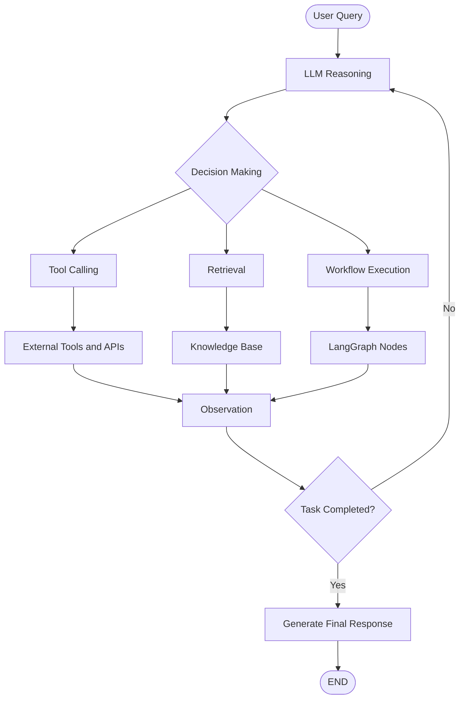
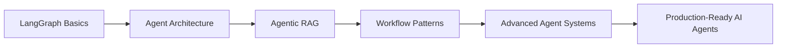

# 🤖 Agentic AI — Building Intelligent AI Agents

Welcome to **Agentic AI**, a hands-on learning journey focused on understanding, designing, and implementing intelligent AI agents using modern frameworks such as **LangGraph and LangChain**.

This section of my [GenerativeAI-Learn](https://github.com/connectwithaadi/GenerativeAI-Learn) repository explores the fundamentals of AI agents, graph-based workflows, agent architectures, and advanced agentic systems.

The goal is to move beyond traditional LLM applications and understand how AI systems can reason, make decisions, interact with tools, manage state, and execute complex workflows autonomously.

---

## 🧠 What is Agentic AI?

Agentic AI refers to AI systems capable of making decisions, planning actions, interacting with external tools, and executing multi-step tasks to achieve a specific objective.

Unlike a traditional LLM application that follows a fixed sequence, an AI agent can dynamically determine its next action based on the current context and available information.

## 🏗️ Agentic AI Learning Architecture

---

## 📚 Concepts & Learning Modules

### 1️⃣ LangGraph Basics

Explore the fundamentals of LangGraph and learn how to build stateful AI workflows using graphs, nodes, edges, and structured state management.

**Topics Covered:**
- Simple Graph Construction
- Chatbot Development
- DataClass-Based State Schema
- Pydantic State Validation
- LLM Chains

📂 **Resources:**

- [📁 LangGraph Basics](./1-LangGraph%20Basics/)
- [1. Simple Graph](./1-LangGraph%20Basics/1-simplegraph.ipynb)
- [2. Chatbot](./1-LangGraph%20Basics/2-Chatbot.ipynb)
- [3. DataClass State Schema](./1-LangGraph%20Basics/3-DataClass-StateSchema.ipynb)
- [4. Pydantic](./1-LangGraph%20Basics/4-Pydantic.ipynb)
- [5. Chains](./1-LangGraph%20Basics/5-Chains.ipynb)

---

### 2️⃣ Agents Architecture

Understand how AI agents are structured, how they interact with tools, and how their execution can be controlled and monitored.

**Topics Covered:**
- ReAct Agent Architecture
- Streaming Responses
- Agent Debugging
- Agent Execution Workflows

📂 **Resources:**

- [📁 Agents Architecture](./2-Agents%20Architecture/)
- [1. ReAct Agent](./2-Agents%20Architecture/1-ReActAgent/)
- [2. Streaming](./2-Agents%20Architecture/2-Streaming/)
- [3. Debugging](./2-Agents%20Architecture/Debugging/)

---

### 3️⃣ Agentic RAG

Explore intelligent Retrieval-Augmented Generation systems that combine LLM reasoning, retrieval mechanisms, and agentic decision-making.

**Topics Covered:**
- Agentic Retrieval-Augmented Generation
- Intelligent Retrieval Workflows
- LLM-Powered Reasoning
- Context-Aware Response Generation

📂 **Resources:**

- [📁 Agentic RAG](./3-Agentic%20RAG/)
- [1. Agentic RAG Implementation](./3-Agentic%20RAG/1-AgenticRAG/)

---

### 4️⃣ Different Workflows in LangGraph

Learn how to design flexible LLM workflows using different orchestration patterns.

**Topics Covered:**
- Prompt Chaining
- Parallelization
- Routing
- Orchestrator–Worker
- Evaluator–Optimizer

📂 **Resources:**

- [📁 Different Workflows in LangGraph](./10-Different%20Workflows%20in%20langgraph/)
- [1. Prompt Chaining](./10-Different%20Workflows%20in%20langgraph/1-Prompt_Chaining.ipynb)
- [2. Parallelization](./10-Different%20Workflows%20in%20langgraph/2-Parallelization.ipynb)
- [3. Routing](./10-Different%20Workflows%20in%20langgraph/3-Routing.ipynb)
- [4. Orchestrator–Worker](./10-Different%20Workflows%20in%20langgraph/4-Orchestrator-worker.ipynb)
- [5. Evaluator–Optimizer](./10-Different%20Workflows%20in%20langgraph/5-Evaluator-optimizer.ipynb)

---

## 🎯 Learning Objectives

Through these hands-on implementations, I am exploring:

- Understanding AI agent architectures and their execution cycles.
- Building stateful workflows using LangGraph.
- Developing LLM-powered chatbots.
- Managing agent state using structured schemas.
- Integrating tools and external APIs with LLMs.
- Implementing ReAct-based reasoning and action execution.
- Designing conditional and dynamic workflows.
- Implementing Agentic RAG architectures.
- Understanding parallel execution and task orchestration.
- Building reliable and context-aware AI applications.

---

## 🛠️ Technologies & Tools

| Technology | Purpose |
|---|---|
| Python | Core programming language |
| LangGraph | Stateful workflow orchestration |
| LangChain | LLM application development |
| Groq | LLM inference |
| Pydantic | Structured data validation |
| DataClasses | State schema management |
| TypedDict | Typed state representation |
| Jupyter Notebook | Hands-on experimentation |
| Large Language Models | Reasoning and generation |
| Retrieval-Augmented Generation | Knowledge-grounded responses |

---

## 🧭 Learning Roadmap

The repository is continuously evolving as I explore more advanced concepts in agentic systems, multi-agent orchestration, retrieval architectures, and production-level AI applications.

---

## 📖 References & Documentation

- [LangGraph Documentation](https://docs.langchain.com/oss/python/langgraph/overview)
- [LangGraph Workflows and Agents](https://docs.langchain.com/oss/python/langgraph/workflows-agents)
- [LangChain Documentation](https://python.langchain.com/docs/introduction/)
- [Groq Documentation](https://console.groq.com/docs/)
- [Pydantic Documentation](https://docs.pydantic.dev/)

---

## 👨‍💻 Author

**Aditya Kumar Singh**

GitHub: [@connectwithaadi](https://github.com/connectwithaadi)

---

⭐ This project is part of my Generative AI and Agentic AI learning journey.

