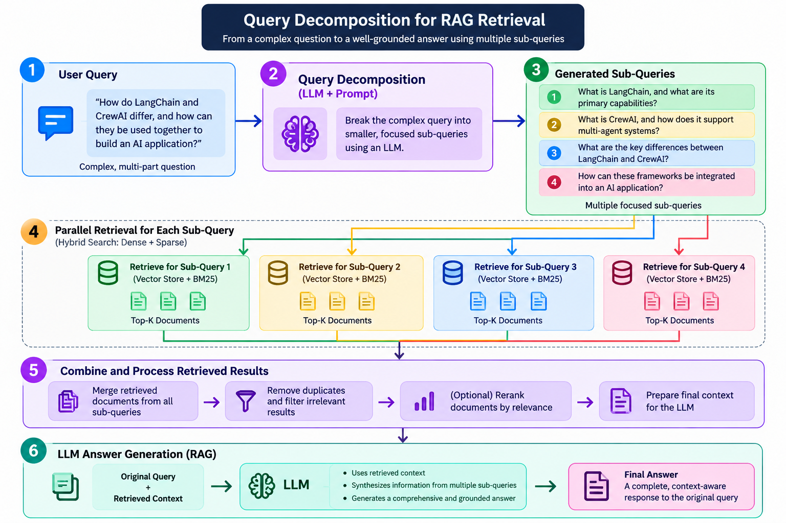

# 🔍 Query Decomposition — Improving RAG Retrieval

A hands-on Generative AI project exploring **Query Decomposition**, a query enhancement technique used to improve information retrieval in Retrieval-Augmented Generation (RAG) systems.

The project demonstrates how a complex user query can be broken down into smaller, more manageable sub-queries, allowing a retrieval system to search for information more effectively.

It uses **LangChain, an LLM, and a CrewAI-related dataset** to explore query decomposition and understand how breaking down complex questions can support better retrieval and answer generation.

---


## 🎯 Learning Objectives

- Understand query decomposition in RAG systems.
- Learn why complex queries can be difficult to retrieve information for.
- Break complex questions into smaller sub-queries.
- Understand how sub-queries can improve information retrieval.
- Explore query enhancement techniques using LLMs.
- Work with text datasets for retrieval experiments.
- Understand how query decomposition fits into a RAG pipeline.
- Explore the relationship between query enhancement and retrieval quality.

---

## 🔄 Architecture



The architecture illustrates how a complex user query can be decomposed into smaller sub-queries, retrieved independently, and combined to generate a context-aware answer.

1. **User Query:** Receive a complex, multi-part question.
2. **Query Decomposition:** Use an LLM and prompt to generate focused sub-queries.
3. **Generated Sub-Queries:** Break the original question into distinct information requirements.
4. **Parallel Retrieval:** Retrieve relevant documents for each sub-query.
5. **Combine and Process Results:** Merge retrieved documents, remove duplicates, filter irrelevant results, and optionally rerank them.
6. **LLM Answer Generation:** Combine the original query with the retrieved context to generate a comprehensive answer.


---

## 📂 Project Structure

```text
2-Query Decomposition/
│
├── 2-Query_Decomposition.ipynb
├── langchain_crewai_dataset.txt
└── README.md
```

### Files Overview

| File | Description |
|---|---|
| `2-Query_Decomposition.ipynb` | Notebook for experimenting with query decomposition. |
| `langchain_crewai_dataset.txt` | Text dataset used for the learning and retrieval workflow. |
| `README.md` | Project documentation. |

---

## 🧠 Core Concepts

### 1. What Is Query Decomposition?

Query decomposition is a query enhancement technique in which a complex question is divided into smaller, focused questions.

For example, consider the following question:

**Original query:**

```text
How do LangChain and CrewAI differ, and how can they
be used together to build an AI application?
```

This question contains multiple information requirements. It can be decomposed into smaller queries:

```text
1. What is LangChain, and what are its primary capabilities?

2. What is CrewAI, and how does it support multi-agent systems?

3. What are the key differences between LangChain and CrewAI?

4. How can these frameworks be integrated into an AI application?
```

Each sub-query targets a specific part of the original question.

### 2. Why Query Decomposition Matters

A single complex query may contain several topics, relationships, or requirements. A retrieval system might not retrieve all the relevant information from one search.

Query decomposition helps by:

- Separating different information requirements.
- Making individual searches more focused.
- Improving the chances of retrieving relevant documents for different aspects of a question.
- Supporting answers that require information from multiple sources.

**Important:** Query decomposition can improve retrieval coverage, but it does not guarantee better results. Its effectiveness depends on the quality of the generated sub-queries, the dataset, and the retrieval system.

### 3. Query Decomposition in RAG

In a RAG pipeline, query decomposition can be applied before document retrieval.

The LLM first generates sub-queries from the original question. The retrieval system searches for documents relevant to each sub-query, and the retrieved information is then used to generate the final answer.

---

## ⚙️ Implementation Workflow

The notebook is the primary source for the exact implementation details. The following workflow describes the general query decomposition process.

### Step 1: Prepare the Dataset

The project includes `langchain_crewai_dataset.txt`, which provides text material for the learning and retrieval workflow.

The dataset can be used as the source of information against which the original query and its decomposed sub-queries are explored.

### Step 2: Define the Original Query

Start with a question that requires multiple pieces of information or involves several related concepts.

### Step 3: Generate Sub-Queries

Use an LLM-based decomposition approach to transform the original question into smaller, focused questions.

Each sub-query should represent a distinct information requirement.

### Step 4: Retrieve Relevant Information

Use the generated sub-queries to search for relevant documents or text passages.

This can help retrieve information that a single broad query might miss.

### Step 5: Combine Retrieved Context

Collect the relevant results from the individual searches and prepare the information for answer generation.

If multiple sub-queries return overlapping documents, a production implementation can also deduplicate or rerank the retrieved results.

### Step 6: Generate the Final Answer

Pass the relevant retrieved context to an LLM along with the original question.

The LLM can then generate a consolidated answer addressing the original information requirements.

---

## 🔄 Architecture

```text
       Original User Query
                |
                v
       Query Decomposition
                |
                v
        Generate Sub-Queries
          /      |      \
         v       v       v
      Query 1  Query 2  Query 3
         |       |       |
         v       v       v
      Retrieve Relevant Documents
                |
                v
       Combine Retrieved Context
                |
                v
           LLM Prompt
                |
                v
        Final Generated Answer
```

---

## 🧮 Conceptual Example

Suppose a user asks:

```text
How can I build a multi-agent RAG application
using LangChain and CrewAI?
```

The query may be decomposed into:

1. How does a RAG application work?
2. What role does LangChain play in RAG?
3. How does CrewAI coordinate multiple agents?
4. How can agents use retrieved information to answer questions?

The retrieval system can search for information relevant to each sub-query. The resulting context can then be combined to answer the original question.

This example illustrates the concept; it does not claim that the notebook produces these exact sub-queries.

---

## 🛠️ Technology Stack

| Technology | Purpose |
|---|---|
| Python | Core programming language |
| Jupyter Notebook | Interactive experimentation |
| LangChain | LLM and retrieval workflow ecosystem |
| Large Language Model (LLM) | Query decomposition and answer generation |
| Text dataset | Source material for experiments |
| RAG | Combines retrieval with LLM-generated answers |

The exact models, packages, and retrieval components should be confirmed from the notebook before adding specific dependency or version claims.

---

## 🚀 Getting Started

### Prerequisites

- Python installed on your system.
- Jupyter Notebook or JupyterLab.
- The dependencies required by the notebook.
- Any API credentials required by the configured LLM, if applicable.

### 1. Clone the Repository

```bash
git clone https://github.com/connectwithaadi/GenerativeAI-Learn.git
```

### 2. Navigate to the Project Folder

```bash
cd GenerativeAI-Learn/RAG/5-Query\ Enhancement/2-Query\ Decomposition
```

### 3. Install Dependencies

Install the packages required by the notebook in your Python environment.

Refer to the notebook's import statements and model configuration for the exact dependencies.

### 4. Run the Notebook

Open `2-Query_Decomposition.ipynb` in Jupyter Notebook or JupyterLab and execute its cells in order.

Ensure that the dataset path and any required environment variables match your local setup.

---

## 📌 Key Takeaways

- Query decomposition breaks complex questions into smaller, focused sub-queries.
- Individual sub-queries can target different information requirements.
- Decomposed queries can improve retrieval coverage for multi-part questions.
- Retrieved information must be combined carefully to avoid duplication and irrelevant context.
- Query decomposition is a useful query enhancement strategy for complex RAG applications.
- Retrieval quality should be evaluated rather than assumed to improve automatically.

---

## 🔮 Future Improvements

- Compare retrieval results before and after query decomposition.
- Add a vector database for semantic retrieval.
- Evaluate retrieval quality using Recall@K, Precision@K, and MRR.
- Compare query decomposition with query expansion and query rewriting.
- Add document deduplication and reranking.
- Measure latency and token usage introduced by additional LLM calls.
- Integrate the workflow into a complete RAG application.

---

## 👨‍💻 Author

**Aadi**

Part of my hands-on learning journey toward Generative AI and AI Engineering.
