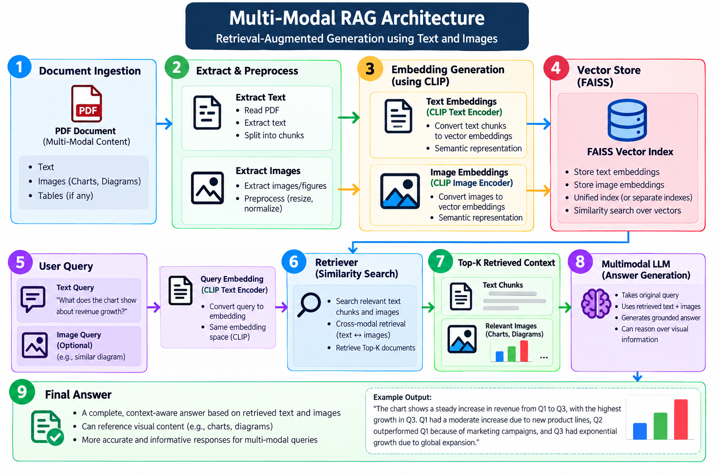

# 🖼️ Multi-Modal RAG — Retrieving Information from Text and Images

A hands-on Generative AI project exploring **Multi-Modal Retrieval-Augmented Generation (RAG)**, combining text and image understanding to retrieve relevant information from documents and generate context-aware answers.

Unlike traditional text-only RAG systems, this project explores how a system can process PDF documents containing text and images, create representations for both modalities, retrieve relevant content, and use a multimodal Large Language Model (LLM) to generate answers.

The project focuses on understanding how **CLIP embeddings, FAISS vector search, document processing, and multimodal LLMs** can work together in a RAG pipeline.

This project is part of my Generative AI learning journey, focusing on advanced RAG architectures and multimodal AI applications.

## 🎯 Learning Objectives

- Understand multimodal RAG and how it differs from text-only RAG.
- Explore extracting text and images from PDF documents.
- Understand text chunking and embedding generation.
- Learn how CLIP connects text and image representations.
- Understand vector similarity search using FAISS.
- Explore retrieving relevant text and image content for a query.
- Understand how retrieved multimodal context can be passed to an LLM.
- Learn how multimodal models can interpret both textual and visual information.
- Study the architecture of a multimodal retrieval pipeline.

## 📂 Project Structure

```text
6-Multi Model RAG/
│
├── 1-multimodel.ipynb
├── multimodal_sample.pdf
└── README.md
```

### File Overview

| File | Description |
|---|---|
| `1-multimodel.ipynb` | Jupyter Notebook containing the practical multimodal RAG implementation and experiments. |
| `multimodal_sample.pdf` | Sample PDF document used as the knowledge source for multimodal processing and retrieval. |
| `README.md` | Project documentation, architecture, and learning notes. |

## 🧠 Core Concepts

### 1. What Is Multi-Modal RAG?

Multi-Modal RAG extends Retrieval-Augmented Generation by working with information from multiple modalities, such as text and images.

A traditional RAG system generally retrieves relevant text passages and supplies them to an LLM. A multimodal RAG system can also retrieve or process visual information, enabling answers that depend on both textual and visual content.

For example, given a PDF containing a technical explanation and a diagram, a multimodal RAG pipeline can retrieve relevant information and provide the model with the context needed to answer questions about the document.

### 2. Why Multi-Modal RAG Matters

Many knowledge sources contain more than plain text, including:

- PDF documents with diagrams and illustrations.
- Reports containing charts and tables.
- Technical documentation with screenshots.
- Presentations containing text and visual explanations.
- Manuals that combine written instructions with images.

Text-only extraction may lose important visual context. Multimodal retrieval helps make this information accessible to downstream LLMs.

### 3. What Is CLIP?

**CLIP (Contrastive Language–Image Pre-training)** is a model that learns compatible representations of images and text.

It can map text and images into a shared embedding space, making it possible to compare their semantic similarity.

In a multimodal retrieval workflow, CLIP can be used to:

- Generate embeddings for images.
- Encode text queries into a compatible representation space.
- Compare text queries with image representations.
- Retrieve images that are semantically relevant to a query.

CLIP is not itself a complete RAG system. It provides a representation mechanism that can be combined with a vector index and a downstream language model.

### 4. What Is FAISS?

**FAISS (Facebook AI Similarity Search)** is a library for efficient similarity search over dense vectors.

In this project architecture, FAISS serves as the retrieval index for searching vector representations and finding relevant candidates.

The quality of retrieval depends on factors such as the embedding model, index configuration, document representation, and similarity-search strategy.

### 5. Multimodal LLMs

A multimodal LLM can accept text and image inputs and use them to generate an answer.

Examples of multimodal model families include OpenAI's GPT-4.1 and Google's Gemini models. The exact model used by this project should be confirmed from the notebook configuration.

The multimodal model operates after retrieval: it receives the original question along with the relevant context and generates a response grounded in the supplied information.

## ⚙️ Implementation Workflow

The following workflow describes the architecture illustrated in the project's reference notes. The notebook remains the source of truth for the exact implementation details.

### Step 1: Load the PDF

Load `multimodal_sample.pdf` as the knowledge source.

The document may contain text, images, diagrams, or other visual elements that provide complementary information.

### Step 2: Extract Text and Images

Process the PDF to obtain its textual and visual content.

Text and images follow separate processing paths because they require different preprocessing and representation techniques.

### Step 3: Create Text Embeddings

Split extracted text into manageable chunks and generate embeddings using the configured embedding model.

These embeddings represent the semantic content of each text chunk.

### Step 4: Create Image Embeddings

Generate image representations using the configured image-embedding model.

The reference architecture highlights CLIP as a mechanism for producing compatible text and image representations.

### Step 5: Build the FAISS Index

Store the supported vector representations in a searchable index.

At query time, the retrieval system uses the query representation to find relevant candidates. The exact index structure and whether text and image vectors share one index or use separate indexes depend on the implementation.

### Step 6: Process the User Query

Convert the user's question into an appropriate representation for retrieval.

For cross-modal image retrieval, a text query can be encoded using the text encoder of a compatible model such as CLIP.

### Step 7: Retrieve Relevant Context

Search the vector index and obtain the most relevant text chunks, images, or associated document information.

The retrieved results provide the evidence needed by the generation stage.

### Step 8: Generate the Multimodal Answer

Pass the original question and the retrieved context to a multimodal LLM.

The model interprets the supplied information and generates a context-aware answer.

## 🏗️ Architecture



### Architecture Explanation

| Component | Responsibility |
|---|---|
| PDF Document | Provides the original knowledge source. |
| Text and Image Extraction | Separates textual and visual content for processing. |
| Text Chunking | Divides extracted text into manageable passages. |
| Text Embeddings | Represent textual content as vectors. |
| Image Embeddings | Represent visual content as vectors. |
| CLIP | Enables compatible text and image representations when configured for the workflow. |
| FAISS | Performs vector similarity search. |
| Retriever | Finds relevant candidates for the user's query. |
| Top-K Context | Supplies the most relevant retrieved information to the generation stage. |
| Multimodal LLM | Uses the question and supplied context to generate an answer. |

**Important:** The diagram documents the conceptual architecture. The exact embedding models, vector-index arrangement, retrieval configuration, and LLM should be verified against the notebook before being treated as implemented details.

## 🔄 End-to-End RAG Flow

1. A PDF containing textual and visual information is loaded.
2. Text and images are extracted and processed.
3. Text chunks and images are represented as embeddings.
4. The representations are made searchable through a vector index.
5. A user submits a natural-language query.
6. The retriever searches for relevant content.
7. The top-K retrieved context is supplied to the multimodal LLM.
8. The LLM generates an answer using the provided context.

## 🛠️ Technology Stack

| Technology / Concept | Purpose |
|---|---|
| Python | Core implementation language. |
| Jupyter Notebook | Interactive development and experimentation. |
| PDF Processing | Extracts text and visual content from PDF documents. |
| Embeddings | Convert supported content into numerical vector representations. |
| CLIP | Supports compatible text and image embeddings. |
| FAISS | Efficient vector similarity search. |
| Multimodal LLM | Processes supported text and image inputs to generate answers. |
| Retrieval-Augmented Generation | Grounds generated responses in retrieved information. |

The exact libraries, model providers, and package versions should be taken from the notebook's imports and configuration.

## 🚀 Getting Started

### Prerequisites

- Python installed on your system.
- Jupyter Notebook or JupyterLab.
- The Python packages required by the notebook.
- API credentials, if the selected model provider requires them.

### 1. Clone the Repository

```bash
git clone https://github.com/connectwithaadi/GenerativeAI-Learn.git
```

### 2. Navigate to the Project Folder

```bash
cd "GenerativeAI-Learn/RAG/6-Multi Model RAG"
```

### 3. Install Dependencies

Install the packages required by `1-multimodel.ipynb`.

Check the notebook's import statements and model configuration for the exact dependencies rather than assuming a fixed package list.

### 4. Configure Credentials

If the implementation uses a hosted LLM or embedding service, configure the required API credentials using environment variables.

Never commit API keys or other secrets to GitHub.

### 5. Run the Notebook

Open `1-multimodel.ipynb` in Jupyter Notebook or JupyterLab and execute the cells in order.

Ensure that `multimodal_sample.pdf` is accessible at the path expected by the notebook.

## 📈 Potential Improvements

- Compare text-only retrieval with multimodal retrieval.
- Evaluate image retrieval using text-based queries.
- Experiment with different embedding models.
- Explore separate text and image indexes versus a unified retrieval strategy.
- Add metadata filtering and document-level source tracking.
- Introduce reranking for improved context relevance.
- Evaluate retrieval using Precision@K, Recall@K, and Mean Reciprocal Rank (MRR).
- Measure latency, memory consumption, and API costs.
- Build a user-facing multimodal RAG application using FastAPI or Streamlit.
- Add source references to make answers easier to verify.

## 📌 Key Takeaways

- Multimodal RAG extends retrieval beyond text-only knowledge sources.
- PDF documents can contain valuable textual and visual information.
- Text and images require appropriate representation techniques.
- CLIP can provide compatible text and image embeddings for cross-modal retrieval.
- FAISS supports efficient similarity search over indexed vectors.
- A multimodal LLM can use retrieved context to generate answers.
- Retrieval quality and answer grounding should be evaluated rather than assumed.
- A reliable multimodal RAG pipeline depends on the complete workflow, from document processing to generation.

## 👨‍💻 Author

**Aadi**

Part of my hands-on learning journey toward Generative AI and AI Engineering.

**Repository:** [GenerativeAI-Learn](https://github.com/connectwithaadi/GenerativeAI-Learn)
