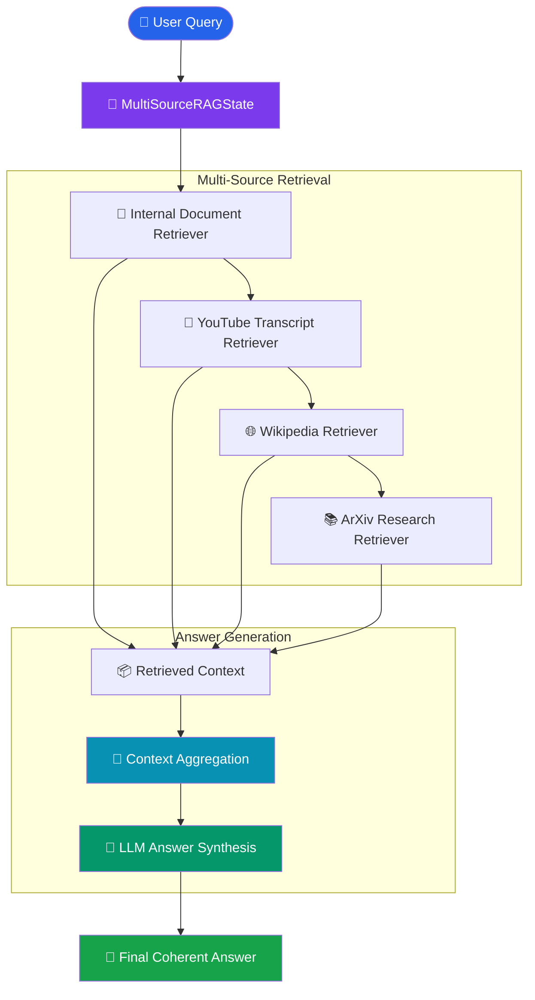

# 🧠 Answer Synthesis from Multiple Sources — Agentic RAG

An Agentic Retrieval-Augmented Generation (RAG) system that retrieves relevant information from multiple knowledge sources and synthesizes it into a single coherent, context-aware answer using LangGraph and an LLM.

Unlike traditional RAG systems that rely on a single retrieval source, this implementation combines internal documents, YouTube transcript data, Wikipedia, and ArXiv research papers to generate comprehensive answers.

## 🚀 Overview

Answer Synthesis is a key capability of Agentic RAG that enables AI systems to:

- Retrieve information from multiple knowledge sources.
- Combine different perspectives and contexts.
- Reduce dependency on a single retrieval source.
- Generate comprehensive and contextual responses.
- Orchestrate retrieval workflows using LangGraph.

## 🏗️ Architecture



## 🔄 Workflow

1. **User Query:** The user submits a natural language question.
2. **State Initialization:** `MultiSourceRAGState` stores the query and retrieved contexts.
3. **Internal Document Retrieval:** FAISS retrieves relevant chunks from `research_notes.txt`.
4. **YouTube Retrieval:** Retrieves relevant transcript information from the embedded transcript data.
5. **Wikipedia Retrieval:** Searches Wikipedia for contextual information.
6. **ArXiv Retrieval:** Fetches relevant academic papers and research content.
7. **Context Aggregation:** Combines all retrieved information into a unified context.
8. **Answer Synthesis:** The LLM generates a comprehensive answer using the aggregated context.
9. **Final Response:** Returns the synthesized answer to the user.

## 🛠️ Tech Stack

| Technology | Purpose |
|---|---|
| Python | Core programming language |
| LangGraph | Workflow orchestration |
| LangChain | LLM and retrieval integration |
| Groq | LLM inference |
| GPT-OSS-120B | Answer synthesis model |
| FAISS | Vector similarity search |
| HuggingFace Embeddings | Text embedding generation |
| Sentence Transformers | `all-MiniLM-L6-v2` embeddings |
| Wikipedia API | Knowledge retrieval |
| ArXiv | Academic research retrieval |
| Pydantic | State management |

## 📂 Project Structure

```text
5-Answer Synthesis/
│
├── 5-AnswerSynthesis.ipynb
├── README.md
└── research_notes.txt
```

## ⚙️ Installation & Setup

### 1. Clone the Repository

```bash
git clone https://github.com/connectwithaadi/GenerativeAI-Learn.git
```

```bash
cd GenerativeAI-Learn
```

### 2. Navigate to the Folder

```bash
cd "RAG/7-Autonomous RAG/5-Answer Synthesis"
```

### 3. Install Dependencies

```bash
pip install langchain langchain-community langchain-core langchain-groq langchain-huggingface langchain-text-splitters langgraph faiss-cpu sentence-transformers pydantic python-dotenv arxiv wikipedia
```

### 4. Configure Environment Variables

Create a `.env` file:

```env
GROQ_API_KEY=your_groq_api_key
```

### 5. Run the Notebook

```bash
jupyter notebook 5-AnswerSynthesis.ipynb
```

Execute the notebook cells sequentially to initialize the retrievers, build the LangGraph workflow, and generate the synthesized response.

## 💡 Example Query

```python
question = "What are transformer agents and how are they evolving in recent research?"
```

The system retrieves relevant information from internal notes, YouTube transcript data, Wikipedia, and ArXiv before generating the final response.

## 🎯 Key Learning Outcomes

- Understanding multi-source retrieval in Agentic RAG.
- Implementing stateful workflows using LangGraph.
- Integrating FAISS-based semantic retrieval.
- Combining internal and external knowledge sources.
- Building context aggregation pipelines.
- Implementing LLM-based answer synthesis.
- Understanding modular retrieval architecture.

## 🔮 Future Improvements

- Implement parallel retrieval using LangGraph.
- Add a supervisor agent for retrieval source selection.
- Introduce query planning and decomposition.
- Add relevance scoring and reranking.
- Implement citation-aware answer synthesis.
- Add source-grounded hallucination detection.
- Integrate SQL databases and real-time APIs.
- Implement iterative retrieval and self-reflection.

## 👨‍💻 Author

**Aditya Kumar Singh (Aadi)**

AI/ML Engineer | Generative AI | Agentic AI | RAG Systems

- GitHub: [@connectwithaadi](https://github.com/connectwithaadi)

---

⭐ If you find this project useful, consider giving the repository a star!

