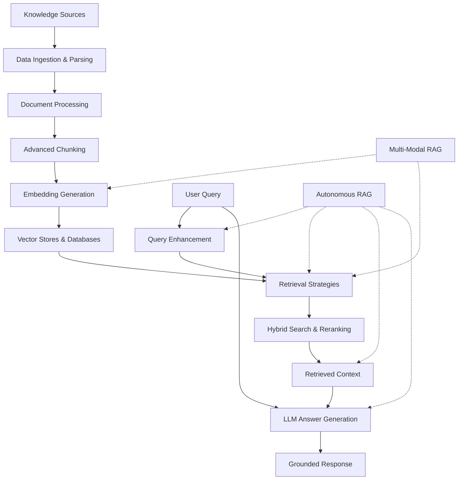
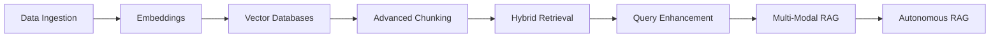

# 🚀 Retrieval-Augmented Generation (RAG) — Generative AI Learning Repository

A comprehensive, hands-on learning journey covering **Retrieval-Augmented Generation (RAG)** — from foundational document processing and embedding techniques to advanced retrieval strategies, multimodal RAG, and autonomous RAG architectures.

This repository is part of my Generative AI and AI Engineering learning journey. It contains practical Jupyter notebooks, supporting datasets, study notes, and individual module documentation designed to build a strong understanding of modern RAG systems.

The goal is to understand not only how RAG works, but also how its individual components contribute to building more effective, context-aware, and knowledge-grounded AI applications.

---

## 🎯 Learning Objectives

- Understand the fundamentals of Retrieval-Augmented Generation.
- Process and ingest data from different document formats and sources.
- Generate embeddings and perform semantic search.
- Explore vector stores and vector databases.
- Implement advanced document chunking strategies.
- Improve retrieval quality using hybrid search and reranking.
- Enhance user queries through expansion and decomposition.
- Explore multimodal retrieval using text and image representations.
- Understand autonomous RAG workflows and reasoning-driven retrieval.
- Build a foundation for designing advanced RAG applications.

---

## 🗺️ RAG Learning Roadmap

The repository is organized into progressive modules, moving from foundational concepts to advanced RAG architectures.

| No. | Module | Learning Focus | Documentation |
|:---:|---|---|---|
| 00 | Data Ingestion & Parsing | Loading, parsing, and preparing structured and unstructured data | [README](./0-DataIngestParsing/README.md) |
| 01 | Vector Embeddings & Databases | Embeddings, vector representations, and semantic similarity | [README](./1-VectorEmbeddingsAndDatabases/README.md) |
| 02 | Vector Stores & Vector Databases | Vector storage, indexing, and similarity-based retrieval | [README](./2-Vector%20Stores%20and%20Vector%20Databases/README.md) |
| 03 | Advanced Chunking | Semantic chunking and context-aware document segmentation | [README](./3-Advance%20Chunking/README.md) |
| 04 | Hybrid Search Strategies | Dense and sparse retrieval, reranking, and MMR | [README](./4-Hybrid%20Search%20Strategies/README.md) |
| 05 | Query Enhancement | Query expansion and query decomposition | [README](./5-Query%20Enhancement/README.md) |
| 06 | Multi-Modal RAG | Retrieving information from text and images | [README](./6-Multi%20Model%20RAG/README.md) |
| 07 | Autonomous RAG | Reasoning, query planning, iterative retrieval, and answer synthesis | [README](./7-Autonomous%20RAG/README.md) |

---

## 🏗️ RAG Architecture Overview

The following Mermaid diagram illustrates the conceptual progression of the learning modules and how their components can contribute to a RAG system.



> **Note:** This is a conceptual architecture for the overall learning roadmap. It does not represent a single end-to-end implementation contained in one notebook. Individual modules explore different techniques and workflows.

---

## 📚 Detailed Module Overview

### 00 — Data Ingestion & Parsing

Explore how raw information is loaded and transformed into usable document representations.

Topics include:
- LangChain Document objects
- Text data ingestion
- PDF parsing
- DOCX parsing
- CSV and Excel parsing
- JSON parsing
- Database parsing
- Document metadata
- Text preparation for downstream retrieval

[Explore Data Ingestion & Parsing →](./0-DataIngestParsing/README.md)

### 01 — Vector Embeddings & Databases

Understand how textual information is converted into numerical vector representations.

Topics include:
- Embedding fundamentals
- Vector representations
- Cosine similarity
- Hugging Face embeddings
- OpenAI embeddings
- Semantic search fundamentals

[Explore Vector Embeddings →](./1-VectorEmbeddingsAndDatabases/README.md)

### 02 — Vector Stores & Vector Databases

Explore how embeddings are stored, indexed, and retrieved efficiently.

Topics include:
- ChromaDB
- FAISS
- InMemoryVectorStore
- Astra DB
- Pinecone
- Similarity search
- Vector storage and retrieval

[Explore Vector Stores →](./2-Vector%20Stores%20and%20Vector%20Databases/README.md)

### 03 — Advanced Chunking

Understand how document segmentation affects retrieval quality and contextual relevance.

Topics include:
- Semantic chunking
- Sentence embeddings
- Cosine similarity
- Threshold-based chunking
- LangChain SemanticChunker
- Context-aware document segmentation

[Explore Advanced Chunking →](./3-Advance%20Chunking/README.md)

### 04 — Hybrid Search Strategies

Explore techniques that combine complementary retrieval approaches.

Topics include:
- Dense retrieval
- Sparse retrieval
- Hybrid search
- EnsembleRetriever
- Reranking
- Maximal Marginal Relevance (MMR)
- Relevance and diversity-aware retrieval

[Explore Hybrid Search →](./4-Hybrid%20Search%20Strategies/README.md)

### 05 — Query Enhancement

Learn how user queries can be transformed before retrieval.

Topics include:
- Query expansion
- Alternative query generation
- Query decomposition
- Complex query handling
- LLM-based query transformation

[Explore Query Enhancement →](./5-Query%20Enhancement/README.md)

### 06 — Multi-Modal RAG

Explore retrieval workflows that work with both textual and visual information.

Topics include:
- Multimodal RAG fundamentals
- PDF text and image processing
- CLIP embeddings
- FAISS vector search
- Text and image retrieval
- Multimodal LLMs

[Explore Multi-Modal RAG →](./6-Multi%20Model%20RAG/README.md)

### 07 — Autonomous RAG

Explore reasoning-driven retrieval workflows capable of planning and refining information retrieval.

Topics include:
- Chain of Thought
- Self-Reflection
- Query Planning and Decomposition
- Iterative Retrieval
- Answer Synthesis
- Autonomous retrieval workflows
- LangGraph-based orchestration concepts

[Explore Autonomous RAG →](./7-Autonomous%20RAG/README.md)

---

## 🛠️ Technology Stack

| Technology | Purpose |
|---|---|
| Python | Core implementation language |
| Jupyter Notebook | Interactive experimentation |
| LangChain | LLM application and retrieval components |
| LangGraph | Workflow orchestration and autonomous RAG concepts |
| Hugging Face | Embedding models and model integrations |
| OpenAI | Embedding and LLM integrations |
| FAISS | Vector similarity search |
| ChromaDB | Vector storage and retrieval |
| Pinecone | Managed vector database |
| Astra DB | Cloud-based vector storage |
| Sentence Transformers | Semantic embedding generation |
| NumPy | Numerical and vector operations |

The technologies used vary across modules. Refer to the individual README files and notebook imports for module-specific requirements.

---

## 🚀 Getting Started

### 1. Clone the Repository

```bash
git clone https://github.com/connectwithaadi/GenerativeAI-Learn.git
```

### 2. Navigate to the RAG Directory

```bash
cd GenerativeAI-Learn/RAG
```

### 3. Set Up Python Environment

Create a virtual environment:

```bash
python -m venv .venv
```

Activate it on Windows PowerShell:

```powershell
.\.venv\Scripts\Activate.ps1
```

Activate it on Linux or macOS:

```bash
source .venv/bin/activate
```

### 4. Install Dependencies

Install the dependencies required for the specific notebook you want to explore.

For example:

```bash
python -m pip install jupyter langchain langchain-community
```

Additional packages may be required for embeddings, vector databases, document parsing, or model integrations.

### 5. Explore the Modules

Start with `0-DataIngestParsing` and gradually progress through the modules.

Open the notebooks using Jupyter Notebook, JupyterLab, or VS Code.

Execute notebook cells in order and refer to the corresponding README for additional explanations.

### 6. Configure API Credentials

Some notebooks may require API credentials for hosted embedding models, LLM providers, or cloud vector databases.

Use environment variables or a local `.env` file.

Never commit API keys or secrets to GitHub.

---

## 📈 Learning Progression



This progression builds an understanding of the individual components before exploring more advanced retrieval architectures.

---

## 🔮 Future Enhancements

- Develop a complete end-to-end RAG application.
- Integrate multiple retrieval strategies into a unified pipeline.
- Explore advanced metadata filtering.
- Implement retrieval evaluation using Precision@K, Recall@K, and MRR.
- Experiment with retrieval latency optimization.
- Integrate reranking into production-oriented RAG workflows.
- Explore multi-agent retrieval architectures.
- Build scalable RAG applications using FastAPI.
- Implement evaluation, monitoring, and observability for RAG systems.

---

## 👨‍💻 Author

**Aditya Kumar Singh (Aadi)**

AI/ML Engineer | Generative AI | Agentic AI | RAG Systems

GitHub: [@connectwithaadi](https://github.com/connectwithaadi)

---

⭐ If you find this repository useful for learning Generative AI and RAG, feel free to explore the notebooks and follow the learning journey.
